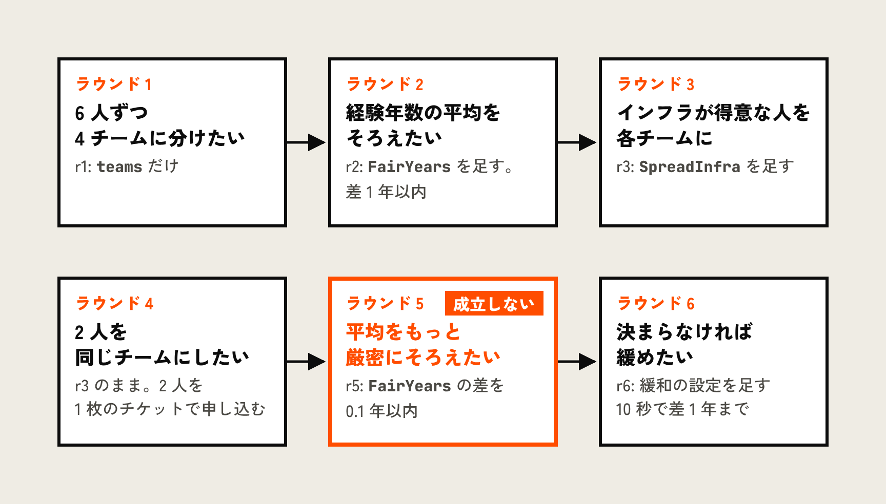
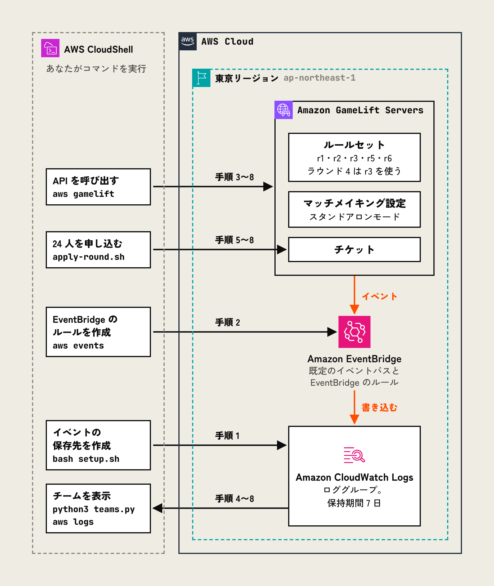
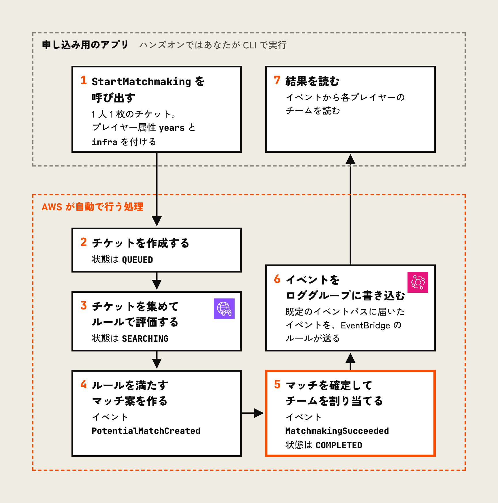
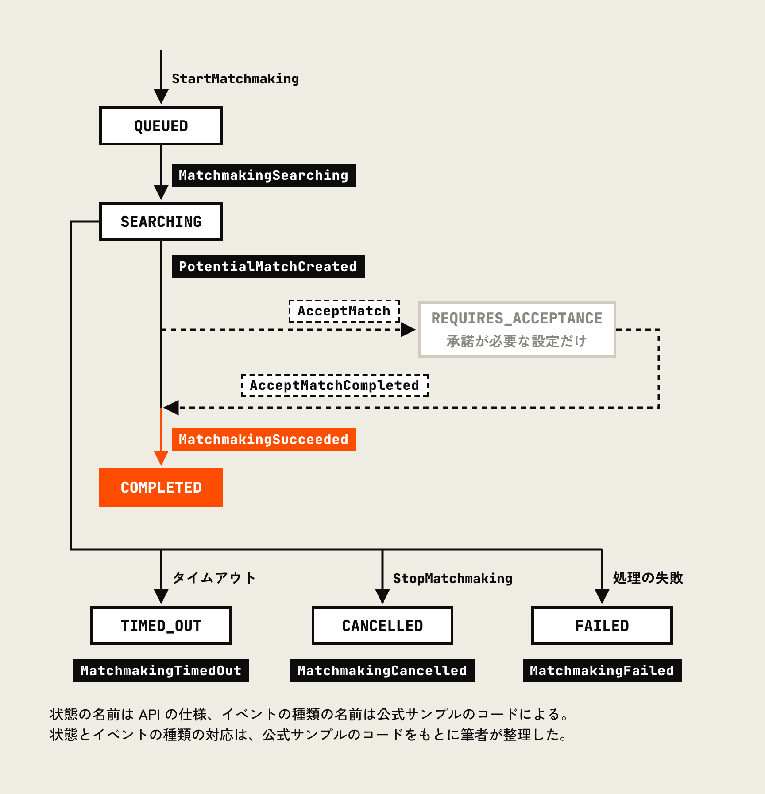
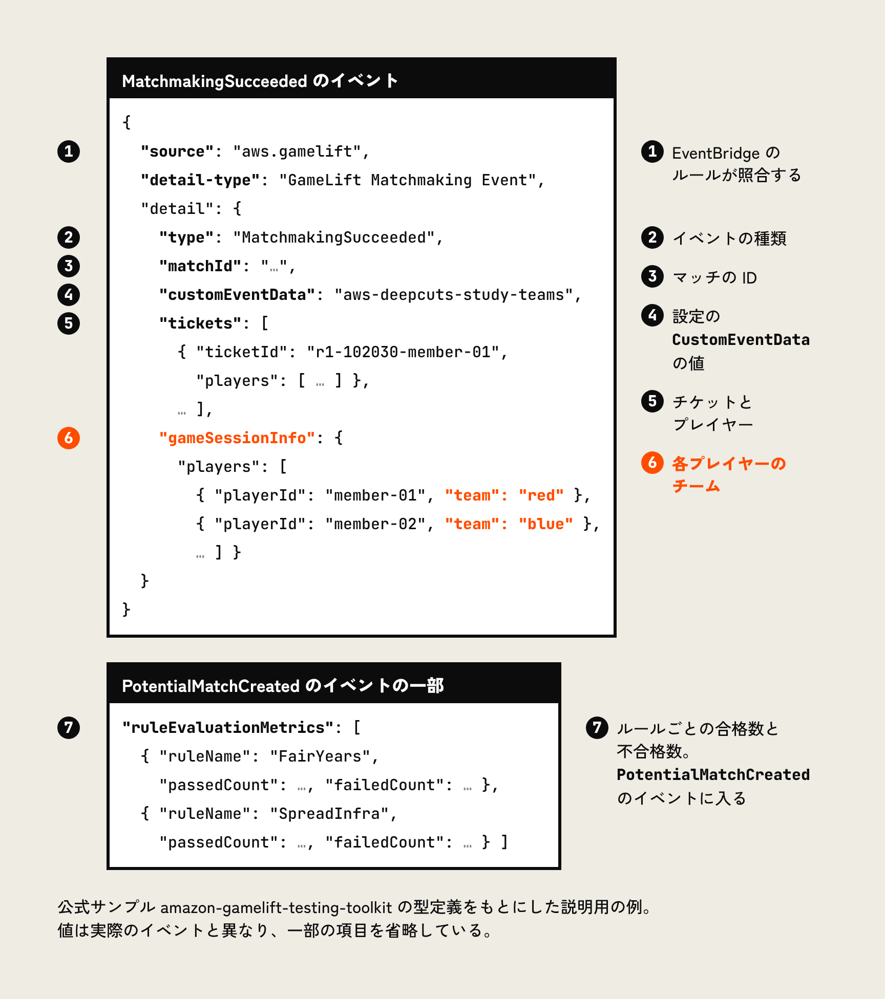
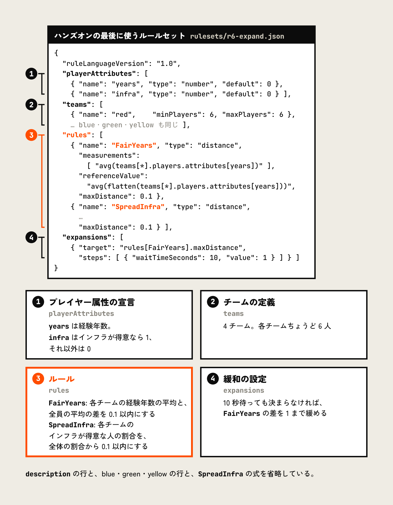

このリポジトリは AWS Deep Cuts の、Amazon GameLift Servers の FlexMatch に関するハンズオンコンテンツです。

<!-- TODO: 記事の公開後に、次の行のリンクを有効にする -->
<!-- Amazon GameLift Servers の FlexMatch の解説記事(Qiita)は[こちら]() -->

解説記事の原稿は [article/amazon-gamelift-servers.md](./article/amazon-gamelift-servers.md) にあります。

<!-- 要確認: C20・C21 執筆の前に、ラウンド 1〜4・6 が申し込みのタイムアウトまでに成立するかと、apply-round.sh の申し込みにかかる秒数を CloudShell で確かめる。成立が確かめられたラウンドは「成立する見込み」を「成立する」に直し、そのラウンドの要確認のコメントを外す。成立しなかったラウンドは、予備のルールセットを rulesets/ に移して本来のルールセットにし、README・記事・図の値を直す -->

> **Note**: Amazon GameLift Servers は、2025 年 3 月に Amazon GameLift から名前が変わったサービスです。API と AWS CLI のコマンドの名前は、今も `gamelift` です。公式のリリースノートによると、このハンズオンで使う FlexMatch のスタンドアロンモードは、2020 年 11 月 24 日に公開されました。
> - このハンズオンは、ブラウザから AWS CLI のコマンドを実行できる AWS CloudShell を使って、東京リージョン（`ap-northeast-1`）で実施します。
> - ゲームサーバー・フリート・IAM ロールは作成しません。
> - 参加者のデータは、すべて架空のものです。実在の人の名前は入れないでください。

> ⚠️ **コストに関する注意**
>
> このハンズオンで料金がかかるのは、FlexMatch のプレイヤーパッケージとマッチメイキング時間の 2 つです。プレイヤーパッケージは、申し込んだプレイヤーの数に応じてかかる料金の単位です。マッチメイキング時間は、FlexMatch がマッチメイキングを処理した時間に応じてかかる料金の単位です。ルールセットとマッチメイキング設定を作成しておくことには、AWS の価格表である AWS Price List に料金の項目がありません。
>
> | 放置期間 | 概算コストの上限 |
> | --- | --- |
> | 1日 | 最大で約 **$4.84**（約 770 円） |
> | 1週間 | 最大で約 **$4.84**（約 770 円） |
>
> 放置しても、金額は増えません。申し込みは、申し込みのタイムアウトとして設定する 120 秒が過ぎると必ず終わるためです。イベントを保存するロググループの保管料金は、1 セント未満です。
>
> この金額は、手順どおりに進めた場合の上限です。次の 4 つの条件で計算し、1 ドル 160 円で換算しています。内訳は [費用の見積もり](#費用の見積もり) にあります。
>
> - 手順 4 の試しの申し込みと 6 回のラウンドで、チケット 144 枚・プレイヤー 145 人を申し込むものとします。チケットは、1 回の申し込みで作られる記録です。
> - マッチメイキング時間は、チケットに含まれるプレイヤー 1 人ごとに、チケットが処理中だった時間をすべて数えるものと仮定します。そのうえで、どのチケットも申し込みのタイムアウトの 120 秒まで処理中だったものとします。145 人 × 120 秒は、約 4.83 時間です。
> - プレイヤーパッケージは、プレイヤー 1 人につき 1 個と仮定します。
> - CloudWatch Logs の料金は、イベントの量と、CloudWatch Logs Insights のクエリで読むデータの量が、どちらも 1 MB 未満のため、1 セント未満とします。
>
> **ラウンドを 1 回やり直すと、最大で約 $0.80（約 130 円）増えます。予備のルールセットでの再実行と、任意の追加のラウンドも、それぞれ 1 回のやり直しとして数えます。やり直すと、マッチメイキング時間の合計が無料枠の 5 時間を超える可能性があります。**
>
> AWS Price List には、毎月 5 時間のマッチメイキング時間と、毎月 50,000 個のプレイヤーパッケージの無料枠があります。無料枠の対象のアカウントであれば、上限の約 4.83 時間と 145 個は無料枠に収まるため、料金は $0 です。ただし、無料枠が適用される期間と、アカウントの種類による扱いは、Price List からは分かりません。
>
> **検証が終わったら速やかに後片付けを実施してください。**

# AWS Deep Cutsとは
AWS Deep Cutsは、AWS の最新のサービスやニッチな機能、または高度にアカデミックな知識を要求するサービスなど、多くの人が知らない 『隠れた名曲 = **Deep Cuts**』 を深くまで掘り下げる技術シリーズです。

このようなサービスはWeb情報も少なく、初学者は気軽にキャッチアップできないのが実情です。

そこで AWS Deep Cuts シリーズでは、**前提知識も含めた分かりやすいサービス解説** と **手順通りに進めれば誰でも再現できるハンズオン** を提供します！

# ハンズオンのゴール

このハンズオンでは、架空の勉強会の参加者 24 人を、Amazon GameLift Servers の FlexMatch で 6 人ずつ 4 チームに分けます。FlexMatch は、ゲームの対戦相手を探してチームに分ける、マッチメイキングの機能です。このハンズオンでは、ゲームサーバーを使わずに FlexMatch だけを使うスタンドアロンモードで、チーム分けの結果だけを受け取ります。

あなたは、勉強会でチーム分けをする幹事です。FlexMatch は、ルールセットと呼ぶ JSON に書いた条件に沿って、参加者をチームに分けます。幹事の要望を、ラウンドごとに 1 つずつルールセットに足していきます。ルールセットを 1 つ選んで全員を申し込み、結果を受け取るまでを、ラウンドと呼びます。6 回のラウンドの流れは、次の図のとおりです。



AWS CLI のコマンドを 1 つずつ実行しながら、FlexMatch の次の 4 つの特徴を自分の目で確かめます。

| 確かめる特徴 | 手順 |
| --- | --- |
| ゲームサーバーなしで、チームの割り当てだけをイベントで受け取れる | 4・5 |
| チーム分けの条件をルールセットのルールで宣言でき、ルールを足すと結果が変わる | 6 |
| 1 枚のチケットに入れたプレイヤーは同じチームになる | 7 |
| 満たせないルールでは、チケットが申し込みのタイムアウトまで処理中のまま残る。緩和の設定を使うと、待ち時間に応じて条件が緩む | 8 |

用語の意味と仕組みは、解説記事で説明しています。先に記事の「Amazon GameLift ServersのFlexMatchとは？」と「仕組み」を読んでおくと、各手順で何を確かめているのかが分かりやすくなります。

# ハンズオン手順

以降の手順は、ハンズオン用に用意した AWS アカウントで実施してください。

## 構築するアーキテクチャ



この README では、FlexMatch のサービスが AWS の中で自動で行う処理を「FlexMatch が〜する」と書きます。

- あなたは CloudShell から AWS CLI のコマンドを実行し、FlexMatch の API を呼び出します。CLI のコマンドの名前は、API の名前に対応しています。たとえば `create-matchmaking-rule-set` コマンドは、`CreateMatchmakingRuleSet` API を呼び出します。
- `setup.sh` は、イベントを保存するロググループと、EventBridge がそこに書き込むためのリソースポリシーを作成します。
- あなたが手順 2 で作成する EventBridge のルールは、既定のイベントバスに届いた FlexMatch のイベントを、ロググループに書き込みます。
- `apply-round.sh` は、参加者 24 人の申し込みを、1 人ずつ繰り返します。
- `teams.py` は、ロググループからイベントを読み、チームの表を表示します。

記事では、FlexMatch の API を呼び出してマッチメイキングを申し込むプログラムを「申し込み用のアプリ」と呼んでいます。このハンズオンでは、CloudShell で実行する AWS CLI と `apply-round.sh` がこれに当たります。

この README では、ルールという語が 2 つの意味で出てきます。EventBridge の条件と送り先の組は、必ず「EventBridge のルール」と書きます。単に「ルール」と書くときは、手順 6 で説明する、ルールセットの中の条件を指します。

## 前提条件

- AWS CloudShell を **東京リージョン** で開くこと
- AWS CLI v2 であること。FlexMatch のコマンドと引数を AWS CLI の 2.39.0 が受け付けることは、引数の解析で確かめました。API の呼び出しは、CloudShell で確かめます。AWS CLI の変更履歴には、2025〜2026 年の FlexMatch に関する変更がありません。そのため、CloudShell に入っている AWS CLI v2 で実行できる見込みです。次のコマンドで版を確認します。

  ```bash
  aws --version
  ```

  <!-- 要確認: C16 CloudShell の AWS CLI の版 -->

- Python 3 と、AWS SDK for Python である boto3 があること。`teams.py` が使います。CloudShell には入っている見込みです。`setup.sh` が、boto3 があるかを確かめます。
- AWS アカウントのプランを確かめること。2025 年 7 月 15 日以降に作成した AWS アカウントは、Free プランか Paid プランのどちらかです。Free プランのアカウントで Amazon GameLift Servers を使えるかは、筆者は確かめられていません。次のコマンドで、アカウントのプランを確認します。

  ```bash
  aws freetier get-account-plan-state --region us-east-1 --query '[accountPlanType, accountPlanStatus]' --output text
  ```

  1 列目が `FREE` なら Free プラン、`PAID` なら Paid プランです。`AccessDeniedException` が表示された場合は、このコマンドを実行する権限が無いだけです。そのまま手順 1 に進んでください。手順 3 でアカウントの制限を示すエラーが表示された場合は、[トラブルシューティング](#トラブルシューティング)を確認してください。

  <!-- 要確認: C15 Free プランのアカウントで FlexMatch のルールセットと設定を作成できるか -->

- CloudShell を開いた IAM ユーザーまたは IAM ロールに、FlexMatch・EventBridge・CloudWatch Logs の操作権限があること。`AdministratorAccess` 相当の権限で実施するのが簡単です。

<details>
<summary>最小権限に近い IAM ポリシーの例</summary>

CloudShell を使う権限は、このポリシーとは別に必要です。たとえば AWS 管理ポリシーの `AWSCloudShellFullAccess` をアタッチします。`FreeTier` のステートメントは、無料枠とアカウントのプランを確かめる場合だけ必要です。

```json
{
  "Version": "2012-10-17",
  "Statement": [
    {
      "Sid": "FlexMatch",
      "Effect": "Allow",
      "Action": [
        "gamelift:ValidateMatchmakingRuleSet", "gamelift:CreateMatchmakingRuleSet", "gamelift:DescribeMatchmakingRuleSets", "gamelift:DeleteMatchmakingRuleSet",
        "gamelift:CreateMatchmakingConfiguration", "gamelift:UpdateMatchmakingConfiguration", "gamelift:DescribeMatchmakingConfigurations", "gamelift:DeleteMatchmakingConfiguration",
        "gamelift:StartMatchmaking", "gamelift:DescribeMatchmaking", "gamelift:StopMatchmaking", "gamelift:TagResource"
      ],
      "Resource": "*"
    },
    {
      "Sid": "EventBridgeRule",
      "Effect": "Allow",
      "Action": ["events:PutRule", "events:PutTargets", "events:RemoveTargets", "events:DeleteRule", "events:DescribeRule", "events:ListTargetsByRule"],
      "Resource": "arn:aws:events:*:*:rule/aws-deepcuts-flexmatch-events"
    },
    {
      "Sid": "EventBridgeList",
      "Effect": "Allow",
      "Action": "events:ListRules",
      "Resource": "*"
    },
    {
      "Sid": "Logs",
      "Effect": "Allow",
      "Action": [
        "logs:CreateLogGroup", "logs:PutRetentionPolicy", "logs:TagResource", "logs:DeleteLogGroup", "logs:DescribeLogGroups", "logs:DescribeLogStreams",
        "logs:FilterLogEvents", "logs:GetLogEvents", "logs:PutResourcePolicy", "logs:DeleteResourcePolicy", "logs:DescribeResourcePolicies"
      ],
      "Resource": "*"
    },
    {
      "Sid": "LogsInsights",
      "Effect": "Allow",
      "Action": ["logs:StartQuery", "logs:GetQueryResults", "logs:StopQuery", "logs:GetLogGroupFields", "logs:DescribeQueries"],
      "Resource": "*"
    },
    {
      "Sid": "FreeTier",
      "Effect": "Allow",
      "Action": ["freetier:GetAccountPlanState", "freetier:GetFreeTierUsage"],
      "Resource": "*"
    },
    {
      "Sid": "Identity",
      "Effect": "Allow",
      "Action": "sts:GetCallerIdentity",
      "Resource": "*"
    }
  ]
}
```

このポリシーは、次の表のコマンドと 1 行ずつ突き合わせて作成しました。表には、README で実行するコマンドと、スクリプトの中の API の呼び出しをすべて並べています。

| 使う場面 | コマンド・処理 | 必要な権限 | ポリシーの Sid |
| --- | --- | --- | --- |
| setup.sh | `sts get-caller-identity` | `sts:GetCallerIdentity` | Identity |
| setup.sh・apply-round.sh・手順 3・手順 9 | `gamelift describe-matchmaking-configurations` | `gamelift:DescribeMatchmakingConfigurations` | FlexMatch |
| setup.sh・cleanup.sh・手順 9 | `logs describe-log-groups` | `logs:DescribeLogGroups` | Logs |
| setup.sh | `logs create-log-group --tags` | `logs:CreateLogGroup`、`logs:TagResource` | Logs |
| setup.sh | `logs put-retention-policy` | `logs:PutRetentionPolicy` | Logs |
| setup.sh | `logs put-resource-policy` | `logs:PutResourcePolicy` | Logs |
| 手順 1・cleanup.sh・手順 9 | `logs describe-resource-policies` | `logs:DescribeResourcePolicies` | Logs |
| 手順 2 | `events put-rule`、`events put-targets` | `events:PutRule`、`events:PutTargets` | EventBridgeRule |
| 手順 3・各ラウンド | `gamelift validate-matchmaking-rule-set` | `gamelift:ValidateMatchmakingRuleSet` | FlexMatch |
| 手順 3・各ラウンド | `gamelift create-matchmaking-rule-set --tags` | `gamelift:CreateMatchmakingRuleSet`、`gamelift:TagResource` | FlexMatch |
| 手順 3 | `gamelift create-matchmaking-configuration --tags` | `gamelift:CreateMatchmakingConfiguration`、`gamelift:TagResource` | FlexMatch |
| 各ラウンド | `gamelift update-matchmaking-configuration` | `gamelift:UpdateMatchmakingConfiguration` | FlexMatch |
| 手順 4・apply-round.sh | `gamelift start-matchmaking` | `gamelift:StartMatchmaking` | FlexMatch |
| 手順 4・ラウンド 1・4・5・teams.py の `--from-tickets`・cleanup.sh | `gamelift describe-matchmaking` | `gamelift:DescribeMatchmaking` | FlexMatch |
| 手順 4・cleanup.sh | `gamelift stop-matchmaking` | `gamelift:StopMatchmaking` | FlexMatch |
| 手順 4・teams.py | `logs filter-log-events` | `logs:FilterLogEvents` | Logs |
| ラウンド 6 | CloudWatch Logs Insights のクエリ | `logs:StartQuery`、`logs:GetQueryResults`、`logs:StopQuery`、`logs:GetLogGroupFields`、`logs:DescribeQueries` | LogsInsights |
| cleanup.sh・手順 9 | `gamelift describe-matchmaking-rule-sets` | `gamelift:DescribeMatchmakingRuleSets` | FlexMatch |
| cleanup.sh | `gamelift delete-matchmaking-configuration`、`delete-matchmaking-rule-set` | `gamelift:DeleteMatchmakingConfiguration`、`gamelift:DeleteMatchmakingRuleSet` | FlexMatch |
| cleanup.sh・手順 9 | `events describe-rule` | `events:DescribeRule` | EventBridgeRule |
| cleanup.sh | `events remove-targets`、`events delete-rule` | `events:RemoveTargets`、`events:DeleteRule` | EventBridgeRule |
| トラブルシューティング | `events list-targets-by-rule` | `events:ListTargetsByRule` | EventBridgeRule |
| cleanup.sh | `logs delete-resource-policy`、`logs delete-log-group` | `logs:DeleteResourcePolicy`、`logs:DeleteLogGroup` | Logs |
| 手順 2 のコンソール | EventBridge のルールの一覧 | `events:ListRules` | EventBridgeList |
| 手順 1・4 のコンソール | ロググループのログストリームとログ | `logs:DescribeLogStreams`、`logs:GetLogEvents` | Logs |
| 前提条件の確認 | `freetier get-account-plan-state` | `freetier:GetAccountPlanState` | FreeTier |
| 費用の確認 | `freetier get-free-tier-usage` | `freetier:GetFreeTierUsage` | FreeTier |

`events:ListRules` は、ルールの ARN に絞れるかを確かめていないため、`Resource` を `"*"` にした別のステートメントにしています。マネジメントコンソールの画面は、この表に無い読み取りの API を呼び出す場合があります。コンソールで `AccessDenied` のような表示が出た場合は、その画面の確認は飛ばしてかまいません。各手順の CLI の確認で足ります。

<!-- 要確認: C17 各コンソールの画面が、このポリシーで表示できるか -->
<!-- 要確認: CreateMatchmakingRuleSet と CreateMatchmakingConfiguration に --tags を付けたとき gamelift:TagResource が要るか -->
</details>

以降、各種コマンドは、東京リージョンで開いた[CloudShell](https://docs.aws.amazon.com/cloudshell/latest/userguide/welcome.html)で実行してください。

## １．事前準備

このハンズオンでは、FlexMatch のイベントを保存するロググループと、EventBridge がそのロググループに書き込むことを許可するリソースポリシーを使います。これらのリソースの作成はハンズオンの本質ではないため、`setup.sh` で作成します。

```bash
# このリポジトリをクローン
git clone https://github.com/AWS-Deep-Cuts/amazon-gamelift-servers
cd amazon-gamelift-servers/hands-on

# セットアップスクリプトの実行
bash ./setup.sh

# 以下の文言が表示されればセットアップ成功です
# ✅ セットアップが完了しました！
```

`setup.sh` は、次の 2 つのリソースを作成します。ルールセット・マッチメイキング設定・EventBridge のルールは作成しません。これらは、あなたが手順 2 と手順 3 でコマンドを実行して作成します。

| リソース | 名前 | 用途 |
| --- | --- | --- |
| CloudWatch Logs のロググループ | `/aws/events/aws-deepcuts-flexmatch` | FlexMatch のイベントを保存する。保持期間は 7 日 |
| CloudWatch Logs のリソースポリシー | `aws-deepcuts-flexmatch-events` | EventBridge のルール `aws-deepcuts-flexmatch-events` から、このロググループへの書き込みだけを許可する |

リソースポリシーは、ロググループの側で、AWS のサービスに書き込みを許可するポリシーです。EventBridge のような AWS のサービスがロググループに書き込むには、ロググループを持つアカウントの側で、このポリシーによって書き込みを許可しておく必要があります。

`setup.sh` は、作成したリソースの名前と ARN を `resource-ids.env` に保存しました。ARN（Amazon Resource Name）は、AWS のリソースを一意に指す名前です。次のコマンドでこのファイルを読み込むと、以降のコマンドで変数として使えます。

```bash
source ./resource-ids.env
cat resource-ids.env
```

| 変数 | 中身 | 使う手順 |
| --- | --- | --- |
| `REGION` | リージョン `ap-northeast-1` | すべて |
| `LOG_GROUP` | ロググループの名前 | 4 |
| `LOG_GROUP_ARN` | ロググループの ARN | 2 |
| `LOGS_POLICY_NAME` | リソースポリシーの名前 | 1 |
| `EVENT_RULE_NAME` | EventBridge のルールの名前 `aws-deepcuts-flexmatch-events` | 2 |
| `EVENT_RULE_ARN` | EventBridge のルールの ARN。`setup.sh` が、手順 2 で作成する前に名前から組み立てた値 | 2 |
| `CONFIG_NAME` | マッチメイキング設定の名前 `aws-deepcuts-study-teams` | 3〜8 |
| `RULE_SET_PREFIX` | ルールセットの名前の接頭辞 `aws-deepcuts-teams` | 3・6・8 |

`cat` の出力には、この表に無い `ACCOUNT_ID` も表示されます。`ACCOUNT_ID` は AWS アカウントの ID で、以降の手順のコマンドでは使いません。以降の手順でも、申し込んだチケットの ID などを、このファイルに追記していきます。

> **Note**: CloudShell は、操作しない時間が続くとセッションが終了し、変数が消えます。その場合は、次の 2 行を実行してから続きの手順に進んでください。
>
> ```bash
> cd ~/amazon-gamelift-servers/hands-on
> source ./resource-ids.env
> ```

### 参加者の名簿を確認する

チームに分ける参加者の名簿は、`members.csv` です。

```bash
column -s, -t members.csv
```

| 列 | 意味 |
| --- | --- |
| `player_id` | プレイヤー ID。`member-01`〜`member-24` |
| `years` | 経験年数 |
| `role` | 得意分野。`app` はアプリ開発、`infra` はインフラ、`data` はデータ分析 |
| `infra` | インフラが得意な人は 1、それ以外の人は 0 |

このハンズオンでは、参加者 1 人を、FlexMatch の 1 人のプレイヤーとして申し込みます。プレイヤー ID は、FlexMatch がプレイヤーを区別する ID です。プレイヤー ID は API の仕様で機微情報として扱われるため、実在の名前ではなく、架空の ID にしています。`role` は `teams.py` の表示のためだけに使い、FlexMatch には渡しません。

24 人の経験年数の合計は 121 年で、平均は約 5.04 年です。得意分野は、`app` が 11 人、`data` が 7 人、`infra` が 6 人です。経験年数の平均の約 5.04 年と、インフラが得意な人の 6 人は、手順 6 以降のルールを考えるときに使います。

<!-- 画面写真: CloudWatch Logs のロググループの一覧。/aws/events/aws-deepcuts-flexmatch と保持期間 7 日を枠で囲む -->

> **この手順で確かめること**
> - **やること**: CloudWatch のコンソールの左のメニューから「ロググループ」を開き、`/aws/events/aws-deepcuts-flexmatch` を確認します。次に、CloudShell で次のコマンドを実行し、リソースポリシーの中身を表示します。
>
>   ```bash
>   aws logs describe-resource-policies --region "${REGION}" \
>     --query "resourcePolicies[?policyName=='${LOGS_POLICY_NAME}'].policyDocument" --output text \
>     | python3 -m json.tool
>   ```
>
> - **期待する結果**: ロググループ `/aws/events/aws-deepcuts-flexmatch` があり、保持期間は 7 日、ログストリームは 0 件です。ポリシーの `Principal` に `events.amazonaws.com` があり、`Condition` の `aws:SourceArn` に、`rule/aws-deepcuts-flexmatch-events` で終わる ARN があります。
> - **ここから分かること**: EventBridge がこのロググループに書き込めるのは、まだ作成していない EventBridge のルール `aws-deepcuts-flexmatch-events` から送られたイベントだけです。次の手順で、その EventBridge のルールを作成します。

## ２．結果を受け取る EventBridge のルールを作成する

スタンドアロンモードの FlexMatch は、チームの割り当てをイベントで返します。イベントは、チケットの状態が変わったことを知らせる JSON です。公式のテストツールである amazon-gamelift-testing-toolkit のコードでは、このイベントを Amazon EventBridge の既定のイベントバスで受け取っています。

Amazon EventBridge は、AWS のサービスが発行したイベントを受け取り、条件に合うものを指定した送り先に送るサービスです。イベントが最初に届く場所を、既定のイベントバスと呼びます。EventBridge のルールは、イベントの条件と送り先の組です。条件を書いた JSON を、イベントパターンと呼びます。この手順では、FlexMatch のイベントだけをロググループに書き込む EventBridge のルールを作成します。

まず、イベントパターンを確認します。

```bash
cat event-pattern.json
```

| 項目 | 値 | 意味 |
| --- | --- | --- |
| `source` | `aws.gamelift` | イベントを発行したサービス。GameLift Servers のイベントを表す |
| `detail-type` | `GameLift Matchmaking Event` | イベントの分類。FlexMatch のマッチメイキングのイベントを表す |

この 2 つの値は、公式のテストツールが EventBridge のルールに使っている値と同じです。

### 2-1. EventBridge のルールを作成する

`put-rule` コマンドで、EventBridge のルールを作成します。

```bash
EVENT_RULE_ARN_CREATED=$(aws events put-rule \
  --region "${REGION}" \
  --name "${EVENT_RULE_NAME}" \
  --event-pattern file://event-pattern.json \
  --state ENABLED \
  --description "AWS Deep Cuts: FlexMatch events to CloudWatch Logs" \
  --query RuleArn --output text)
echo "${EVENT_RULE_ARN_CREATED}"
echo "${EVENT_RULE_ARN}"
```

2 行の ARN が同じであることを確認してください。2 行目は、`setup.sh` がリソースポリシーの条件に書いた ARN です。2 つが同じなので、この EventBridge のルールから送られたイベントは、ロググループに書き込めます。

| パラメータ | 指定した値 | 意味 |
| --- | --- | --- |
| `--name` | `aws-deepcuts-flexmatch-events` | EventBridge のルールの名前 |
| `--event-pattern` | `event-pattern.json` | イベントパターン |
| `--state` | `ENABLED` | EventBridge のルールを有効にする |
| `--description` | 説明の文字列 | EventBridge のルールの説明 |

`--event-bus-name` を指定しない場合、EventBridge のルールは既定のイベントバスに作成されます。

### 2-2. 送り先にロググループを指定する

EventBridge のルールがイベントを送る先を、送り先と呼びます。API とコンソールでは、送り先は「ターゲット」と表示されます。`put-targets` で、送り先にロググループを指定します。

```bash
aws events put-targets \
  --region "${REGION}" \
  --rule "${EVENT_RULE_NAME}" \
  --targets "[{\"Id\": \"logs\", \"Arn\": \"${LOG_GROUP_ARN}\"}]"
```

出力の形の例は次のとおりです。

```json
{
    "FailedEntryCount": 0,
    "FailedEntries": []
}
```

| パラメータ | 指定した値 | 意味 |
| --- | --- | --- |
| `--rule` | `aws-deepcuts-flexmatch-events` | 送り先を指定する EventBridge のルール |
| `--targets` の `Id` | `logs` | 送り先の ID。後片付けで送り先を外すときに使う |
| `--targets` の `Arn` | ロググループの ARN | 送り先のロググループ |

これで、既定のイベントバスに、`source` が `aws.gamelift`、`detail-type` が `GameLift Matchmaking Event` のイベントが届くと、EventBridge がロググループにイベントの JSON を書き込むようになりました。書き込みの権限は、手順 1 のリソースポリシーで与えています。FlexMatch の側には、通知先を何も設定しません。

<!-- 要確認: C5 通知先（SNS）を指定しない設定でも FlexMatch のイベントが EventBridge に届くこと -->

<!-- 画面写真: EventBridge コンソールのルール aws-deepcuts-flexmatch-events の「イベントパターン」タブ。source と detail-type を枠で囲む -->

> **この手順で確かめること**
> - **やること**: EventBridge のコンソールの左のメニューから「ルール」を開き、イベントバス `default` の `aws-deepcuts-flexmatch-events` を開きます。「イベントパターン」タブと「ターゲット」タブを確認します。
> - **期待する結果**: イベントパターンが `event-pattern.json` と同じです。ターゲットに、ロググループ `/aws/events/aws-deepcuts-flexmatch` があります。
> - **ここから分かること**: EventBridge のルールは、既定のイベントバスに届いたイベントのうち、イベントパターンに合うものだけをロググループへ送ります。まだイベントは 1 件も届いていないため、ロググループのログストリームは 0 件のままです。FlexMatch の側に何も設定しなくてもイベントが届くかは、手順 4 で確かめます。

<!-- 要確認: C17 EventBridge コンソールのメニューとタブの名前 -->

## ３．ルールセットとマッチメイキング設定を作成する

FlexMatch でチームに分けるには、ルールセットとマッチメイキング設定の 2 つが必要です。ルールセットは、チームの人数とチーム分けの条件を書いた JSON です。マッチメイキング設定は、使うルールセット・モード・申し込みのタイムアウトなどをまとめた設定です。手順 4 以降では、マッチメイキング設定の名前を指定して申し込みます。

### 3-1. ラウンド 1 のルールセットを確認する

```bash
cat rulesets/r1-teams.json
```

| キー | 中身 | 意味 |
| --- | --- | --- |
| `ruleLanguageVersion` | `"1.0"` | ルールセットの書き方の版 |
| `playerAttributes` | `years` と `infra` | プレイヤー属性の宣言。プレイヤー属性は、申し込むときにプレイヤーごとに渡す値。型は数値 `number`。`default` は既定値の欄で、AWS が GitHub で公開している FlexMatch のサンプルのルールセットと同じく、0 を書いている。このハンズオンでは、全員に `years` と `infra` を渡す |
| `teams` | red・blue・green・yellow | チームの名前と人数。`minPlayers` と `maxPlayers` がどちらも 6 のため、各チームはちょうど 6 人になる |

このルールセットには、チーム分けの条件を書く `rules` がありません。人数だけを決めたルールセットです。`years` と `infra` は、ラウンド 2 以降のルールで使うため、ここで宣言しておきます。

### 3-2. ルールセットを検査する

ルールセットは、作成した後に編集できません。そのため、API の説明文は、作成する前に `ValidateMatchmakingRuleSet` で構文を確かめるよう勧めています。`validate-matchmaking-rule-set` で、FlexMatch にルールセットの検査を依頼します。

```bash
aws gamelift validate-matchmaking-rule-set --region "${REGION}" \
  --rule-set-body file://rulesets/r1-teams.json
```

出力の形の例は次のとおりです。

```json
{
    "Valid": true
}
```

検査では、JSON の構文と、許されたプロパティ式に沿っているかが確かめられます。プロパティ式は、ラウンド 2 で使う、ルールの中の式です。壊れたルールセットの検査は、ルールとプロパティ式を説明した後の、ラウンド 2 で行います。

### 3-3. ルールセットを作成する

`create-matchmaking-rule-set` で、FlexMatch にルールセットの作成を依頼します。

```bash
aws gamelift create-matchmaking-rule-set \
  --region "${REGION}" \
  --name "${RULE_SET_PREFIX}-r1" \
  --rule-set-body file://rulesets/r1-teams.json \
  --tags Key=Project,Value=aws-deepcuts \
  --query 'RuleSet.[RuleSetName, RuleSetArn]' --output text
```

出力の形の例は次のとおりです。ARN などの値は環境ごとに異なります。

```text
aws-deepcuts-teams-r1	arn:aws:gamelift:ap-northeast-1:<アカウント ID>:matchmakingruleset/aws-deepcuts-teams-r1
```

| パラメータ | 指定した値 | 意味 |
| --- | --- | --- |
| `--name` | `aws-deepcuts-teams-r1` | ルールセットの名前。使える文字は英数字・ハイフン・ピリオドで、128 文字まで |
| `--rule-set-body` | `rulesets/r1-teams.json` | ルールセットの JSON |
| `--tags` | `Project=aws-deepcuts` | リソースに付けるタグ |

<!-- 要確認: C1 東京リージョンでルールセットと STANDALONE の設定を作成できること -->
<!-- 要確認: C3 API の説明文では、ルールセットの ARN はアカウント ID の欄が空の形で書かれている。実際の ARN にアカウント ID が入るか。入らない場合は上の出力の例を直す -->

### 3-4. マッチメイキング設定を作成する

`create-matchmaking-configuration` で、FlexMatch にマッチメイキング設定の作成を依頼します。

```bash
aws gamelift create-matchmaking-configuration \
  --region "${REGION}" \
  --name "${CONFIG_NAME}" \
  --description "AWS Deep Cuts: study group team assignment" \
  --rule-set-name "${RULE_SET_PREFIX}-r1" \
  --flex-match-mode STANDALONE \
  --request-timeout-seconds 120 \
  --no-acceptance-required \
  --custom-event-data "${CONFIG_NAME}" \
  --tags Key=Project,Value=aws-deepcuts \
  --query 'Configuration.[Name, FlexMatchMode, RuleSetName]' --output text
```

| パラメータ | 指定した値 | 意味 |
| --- | --- | --- |
| `--name` | `aws-deepcuts-study-teams` | マッチメイキング設定の名前。使える文字は英数字・ハイフン・ピリオドで、128 文字まで |
| `--rule-set-name` | `aws-deepcuts-teams-r1` | 使うルールセット |
| `--flex-match-mode` | `STANDALONE` | スタンドアロンモードにする。省いたときの値は API の仕様に書かれていないため、必ず指定する |
| `--request-timeout-seconds` | 120 | チケットが処理中でいられる最長の秒数。1〜43,200 秒。この README では、申し込みのタイムアウトと呼ぶ |
| `--no-acceptance-required` | false | マッチ案をプレイヤーが承諾する必要が無いことを表す |
| `--custom-event-data` | `aws-deepcuts-study-teams` | このマッチメイキング設定に関するすべてのイベントに付く文字列。256 文字まで |
| `--tags` | `Project=aws-deepcuts` | リソースに付けるタグ |

マッチ案は、FlexMatch がルールを満たすプレイヤーの組み合わせとして作る候補です。承諾は、マッチ案をプレイヤーが受け入れるかを確かめる仕組みです。勉強会のチーム分けでは承諾を使わないため、`--no-acceptance-required` を指定します。`AcceptanceRequired` は、スタンドアロンモードでも省けない必須のパラメータです。

次の 2 つは指定しません。

- `--game-session-queue-arns`: ゲームサーバーで対戦を始める仕組みを指定するパラメータです。スタンドアロンモードでは設定しません。
- `--notification-target`: 通知先の Amazon SNS（Amazon Simple Notification Service）のトピックを指定するパラメータです。イベントは、手順 2 の EventBridge のルールで受け取ります。

作成したマッチメイキング設定の詳細を表示します。

```bash
aws gamelift describe-matchmaking-configurations --region "${REGION}" --names "${CONFIG_NAME}"
```

出力の形の例は次のとおりです。一部を省略しています。ARN などの値は環境ごとに異なります。

```json
{
    "Configurations": [
        {
            "Name": "aws-deepcuts-study-teams",
            "ConfigurationArn": "arn:aws:gamelift:ap-northeast-1:<アカウント ID>:matchmakingconfiguration/aws-deepcuts-study-teams",
            "Description": "AWS Deep Cuts: study group team assignment",
            "RequestTimeoutSeconds": 120,
            "AcceptanceRequired": false,
            "RuleSetName": "aws-deepcuts-teams-r1",
            "RuleSetArn": "arn:aws:gamelift:ap-northeast-1:<アカウント ID>:matchmakingruleset/aws-deepcuts-teams-r1",
            "CustomEventData": "aws-deepcuts-study-teams",
            "CreationTime": "...",
            "FlexMatchMode": "STANDALONE"
        }
    ]
}
```

<!-- 画面写真: Amazon GameLift Servers コンソールの FlexMatch のルールセットの一覧。aws-deepcuts-teams-r1 を枠で囲む -->
<!-- 画面写真: Amazon GameLift Servers コンソールのマッチメイキング設定 aws-deepcuts-study-teams の詳細。FlexMatch のモードが Standalone の欄を枠で囲む -->

> **この手順で確かめること**
> - **やること**: 手順 3-2 の出力の `Valid` を確認します。次に、Amazon GameLift Servers のコンソールを開き、左のメニューの FlexMatch の下から、ルールセットの一覧とマッチメイキング設定の一覧を確認します。
> - **期待する結果**: 手順 3-2 の検査で `"Valid": true` が表示されました。コンソールに、ルールセット `aws-deepcuts-teams-r1` と、マッチメイキング設定 `aws-deepcuts-study-teams` があります。マッチメイキング設定の FlexMatch のモードは Standalone です。
> - **ここから分かること**: スタンドアロンモードの FlexMatch で作成したのは、ルールセットとマッチメイキング設定の 2 つだけです。ゲームサーバーを動かすフリートなどは作成していません。また、マッチメイキング設定を作成しただけでは、まだ何も処理されていません。処理は、次の手順でチケットを申し込んだときに始まります。

<!-- 要確認: C17 コンソールのメニューの名前と、マッチメイキング設定の画面での表示名（マッチメーカーなど）。表示名が異なる場合は、手順の中で「画面では〇〇と表示されます」と 1 回だけ書く -->

## ４．試しに 1 人だけ申し込む

本番のラウンドの前に、1 人だけを申し込みます。ルールセット `aws-deepcuts-teams-r1` は 4 チーム × 6 人を求めるため、1 人だけではマッチは成立しません。この手順では、チケットの状態の変化と、イベントが EventBridge を通ってロググループに届くことを確かめます。

1 回の申し込みで AWS の中で起きることは、次の図のとおりです。図の 1 と 7 はあなたが行う操作で、2〜6 は FlexMatch と EventBridge が自動で行う処理です。この手順で通るのは、図の 1〜3 と 6 です。マッチは成立しないため、4 と 5 は通りません。代わりに手順 4-3 で、あなたが `stop-matchmaking` で申し込みを止めます。止めたときの状態の変わり方は、次の状態の図の `CANCELLED` で確かめます。



チケットの状態と、状態が変わるところで届くイベントの種類は、次の図のとおりです。この手順で通る状態は、`QUEUED`・`SEARCHING`・`CANCELLED` です。



### 4-1. 申し込む

`start-matchmaking` で、FlexMatch に 1 人分のマッチメイキングを申し込みます。チケット ID と申し込んだ時刻は、後で使うため `resource-ids.env` に追記します。

```bash
TRIAL_TICKET="trial-$(date +%H%M%S)"
TRIAL_START_MS=$(date +%s%3N)
echo "TRIAL_TICKET=\"${TRIAL_TICKET}\"" >> resource-ids.env
echo "TRIAL_START_MS=\"${TRIAL_START_MS}\"" >> resource-ids.env

aws gamelift start-matchmaking \
  --region "${REGION}" \
  --configuration-name "${CONFIG_NAME}" \
  --ticket-id "${TRIAL_TICKET}" \
  --players '[{"PlayerId": "member-01", "PlayerAttributes": {"years": {"N": 1}, "infra": {"N": 0}}}]'
```

| パラメータ | 指定した値 | 意味 |
| --- | --- | --- |
| `--configuration-name` | `aws-deepcuts-study-teams` | 申し込み先のマッチメイキング設定 |
| `--ticket-id` | `trial-` と時刻 | チケットの ID。英数字・ハイフン・ピリオドで 128 文字まで。省くと FlexMatch が UUID（Universally Unique Identifier）の形の ID を付ける |
| `--players` の `PlayerId` | `member-01` | プレイヤー ID。1 回の申し込みに入れられるプレイヤーは最大 10 人 |
| `--players` の `PlayerAttributes` | `years` は 1、`infra` は 0 | プレイヤー属性。キーはルールセットの `playerAttributes` と一致させる。`N` は数値の型を表す |

出力の形の例は次のとおりです。一部を省略しています。時刻などの値は環境ごとに異なります。

```json
{
    "MatchmakingTicket": {
        "TicketId": "trial-102030",
        "ConfigurationName": "aws-deepcuts-study-teams",
        "ConfigurationArn": "arn:aws:gamelift:ap-northeast-1:<アカウント ID>:matchmakingconfiguration/aws-deepcuts-study-teams",
        "Status": "QUEUED",
        "StartTime": "...",
        "Players": [
            {
                "PlayerId": "member-01",
                "PlayerAttributes": {
                    "years": { "N": 1.0 },
                    "infra": { "N": 0.0 }
                }
            }
        ]
    }
}
```

FlexMatch は、申し込みを受け付けてチケットを作成し、`QUEUED` の状態で返しました。申し込みのタイムアウトは 120 秒です。手順 4-2 と手順 4-3 は、120 秒が過ぎる前に続けて実行してください。

### 4-2. 状態を 1 回だけ確認する

`describe-matchmaking` で、チケットの状態を取得します。

```bash
aws gamelift describe-matchmaking --region "${REGION}" --ticket-ids "${TRIAL_TICKET}" \
  --query 'TicketList[0].[Status, EstimatedWaitTime]' --output text
```

1 列目に `SEARCHING` が表示される見込みです。FlexMatch がマッチを探し始めると、チケットは `SEARCHING` の状態になります。2 列目の `EstimatedWaitTime` は、いまプレイヤーがマッチを待っている平均の秒数です。最近のデータが足りない場合は空になり、`None` と表示されます。

API の説明文によると、`DescribeMatchmaking` は、チケットの状態を追うために繰り返し呼び出す設計ではありません。繰り返し呼び出すと、API の呼び出しの上限を超えてエラーになるおそれがあります。そのため、このハンズオンでは、状態はイベントで受け取り、`describe-matchmaking` は要所で 1 回だけ実行します。

### 4-3. 申し込みを止める

`stop-matchmaking` で、FlexMatch にチケットの処理の停止を依頼し、続けて状態を取得します。

```bash
aws gamelift stop-matchmaking --region "${REGION}" --ticket-id "${TRIAL_TICKET}"

aws gamelift describe-matchmaking --region "${REGION}" --ticket-ids "${TRIAL_TICKET}" \
  --query 'TicketList[0].Status' --output text
```

1 つ目のコマンドは何も表示しません。API は成功すると空の JSON を返し、AWS CLI は応答が空の JSON のときに何も表示しないためです。止まったかどうかは、続けて `describe-matchmaking` で確かめます。2 つ目のコマンドは `CANCELLED` を表示します。申し込みから 120 秒が過ぎていた場合は、`TIMED_OUT` と表示されます。その場合も、次の手順 4-4 に進んでかまいません。

### 4-4. 届いたイベントを確認する

30 秒ほど待ってから、ロググループに書き込まれたイベントの種類を表示します。`--start-time` には、申し込みの時刻の 60 秒前を指定します。イベントの時刻と CloudShell の時計のずれで、最初のイベントを読み落とさないためです。`teams.py` も、同じく 60 秒さかのぼって読みます。

```bash
aws logs filter-log-events --region "${REGION}" --log-group-name "${LOG_GROUP}" \
  --start-time "$((TRIAL_START_MS - 60000))" --query 'events[].message' --output text \
  | grep -o '"type": *"[A-Za-z]*"'
```

出力の形の例は次のとおりです。

```text
"type":"MatchmakingSearching"
"type":"MatchmakingCancelled"
```

続けて、`MatchmakingCancelled` のイベントの JSON を、`jq` で整形して表示します。

```bash
aws logs filter-log-events --region "${REGION}" --log-group-name "${LOG_GROUP}" \
  --start-time "$((TRIAL_START_MS - 60000))" --filter-pattern '"MatchmakingCancelled"' \
  --query 'events[0].message' --output json | jq 'fromjson'
```

`--output json` を指定すると、AWS CLI は `message` の文字列を JSON の文字列として出力します。`jq` の `fromjson` は、その文字列を JSON として読み直して整形します。`--output text` を指定すると、AWS CLI は結果のページごとに `--query` を適用するため、イベントが無いページの分の `None` の行が続けて出力されることがあります。その場合、`python3 -m json.tool` で整形しようとすると、`Extra data` のエラーになります。

出力の形の例は次のとおりです。一部を省略しています。ID や時刻などの値は環境ごとに異なります。

```json
{
  "detail-type": "GameLift Matchmaking Event",
  "source": "aws.gamelift",
  "time": "...",
  "detail": {
    "reason": "Cancelled",
    "tickets": [
      {
        "ticketId": "trial-102030",
        "players": [ { "playerId": "member-01" } ],
        "startTime": "..."
      }
    ],
    "customEventData": "aws-deepcuts-study-teams",
    "type": "MatchmakingCancelled",
    "message": "Cancelled by request."
  }
}
```

1 つ目のコマンドで何も表示されない場合や、2 つ目のコマンドで `null (null) only strings can be parsed` のエラーが表示された場合は、まだイベントが届いていません。1 分待ってから、もう一度実行してください。`python3 teams.py trial` でも、このチケットのイベントの種類と時刻を表示できます。それでもイベントが届かない場合は、[トラブルシューティング](#トラブルシューティング)の「手順 4 でイベントが届かない」の行を確認してください。

<!-- 要確認: C5・C6 届くイベントの種類と順序、届くまでの秒数、message の JSON の空白の有無。出力の例を実物に合わせて直す -->

<!-- 画面写真: CloudWatch Logs のロググループ /aws/events/aws-deepcuts-flexmatch のログストリーム。MatchmakingCancelled のイベントの detail.type を枠で囲む -->

> **この手順で確かめること**
> - **やること**: 手順 4-4 の出力と、CloudWatch のコンソールのロググループ `/aws/events/aws-deepcuts-flexmatch` のログストリームで、イベントの種類と `detail.tickets[0].ticketId` を確認します。
> - **期待する結果**: イベントの種類として、`MatchmakingSearching` と `MatchmakingCancelled` が表示されます。`MatchmakingCancelled` のイベントの `source` は `aws.gamelift`、`detail-type` は `GameLift Matchmaking Event` です。`detail.tickets[0].ticketId` は `TRIAL_TICKET` と同じ値で、`detail.customEventData` は `aws-deepcuts-study-teams` です。
> - **ここから分かること**: チケットの状態は `QUEUED` → `SEARCHING` → `CANCELLED` と変わり、FlexMatch は状態が変わるたびにイベントを発行しました。イベントの種類の名前 `MatchmakingCancelled` は、チケットの状態の名前 `CANCELLED` とは異なります。また、FlexMatch の側には通知先を何も設定していないのに、イベントは EventBridge を通ってロググループに届きました。`customEventData` には、手順 3-4 の `--custom-event-data` で指定した文字列が入っています。

## ラウンドの進め方

手順 5〜8 では、6 回のラウンドでチーム分けを行います。各ラウンドは、次の 5 つの操作の繰り返しです。

| 操作 | コマンド | 誰が行うか |
| --- | --- | --- |
| ① 新しいルールセットとの違いを確かめる | `diff` | あなた |
| ② ルールセットを検査して作成する | `validate-matchmaking-rule-set`・`create-matchmaking-rule-set` | あなた |
| ③ マッチメイキング設定のルールセットを差し替える | `update-matchmaking-configuration` | あなた |
| ④ 24 人を申し込む | `bash ./apply-round.sh <番号>` | あなた。スクリプトが 1 人ずつ `start-matchmaking` を実行する |
| ⑤ チームを表示する | `python3 teams.py <番号>` | あなた |

- ルールセットは作成した後に編集できないため、ルールを変えるときは、新しいルールセットを作成し、マッチメイキング設定が使うルールセットを差し替えます。ラウンド 1 では ①〜③ が無く、手順 3 で作成したルールセットをそのまま使います。
- 前のラウンドのチケットがすべて終わってから、次のラウンドを始めてください。`teams.py` が「すべてのチケットが終わりました」と表示すれば、すべて終わっています。AWS の文書によると、同じプレイヤー ID で処理中のチケットがあると、前のチケットは取り消されます。<!-- 要確認: C9 同じプレイヤー ID で 2 回申し込むと、前のチケットが取り消されるか -->
- `apply-round.sh` は、申し込みにかかった秒数と、最初のチケットが申し込みのタイムアウトになるまでの残りの秒数を表示します。マッチは、24 人ちょうどがそろったときにだけ成立します。最初のチケットが 120 秒で終わるまでに、FlexMatch が条件を満たす分け方を見つけられなければ、そのラウンドのチケットはすべて `MatchmakingTimedOut` のイベントで終わります。
- ラウンド 2・3・4・6 の結果は、筆者がまだ実機で確かめていないため、「成立する見込み」と書いています。成立しなかった場合は、条件を少し緩めた予備のルールセットで、そのラウンドをやり直します。手順は[トラブルシューティング](#トラブルシューティング)にあります。やり直すと、料金が最大で約 $0.80 増えます。

## ５．ラウンド 1：人数だけを決めてチームに分ける

幹事の要望は「まずは 6 人ずつの 4 チームに分けたい」です。手順 3 で作成したルールセット `aws-deepcuts-teams-r1` のまま、24 人を申し込みます。

### 5-1. apply-round.sh の中身を確認する

`apply-round.sh` は、手順 4-1 で 1 人だけ実行した `start-matchmaking` を、24 人分繰り返すスクリプトです。中心のコマンドを表示します。

```bash
grep -n -A5 'aws gamelift start-matchmaking' apply-round.sh
```

```text
116:  if ! status=$(aws gamelift start-matchmaking \
117-      --region "${REGION}" \
118-      --configuration-name "${CONFIG_NAME}" \
119-      --ticket-id "${ticket_id}" \
120-      --players "${players_json}" \
121-      --query MatchmakingTicket.Status --output text 2>&1); then
```

- `ticket_id` は、`r1-102030-member-01` のように、ラウンドの番号と時刻とプレイヤー ID をつないだ値です。
- `players_json` は、`members.csv` の 1 行から作った 1 人分の JSON です。FlexMatch に渡すのは、ルールセットで宣言した `years` と `infra` だけです。
- 1 枚のチケットに複数のプレイヤーを入れると、FlexMatch はその全員を同じチームに入れようとします。そのため、1 人 1 枚で申し込み、誰と誰を同じチームにするかを FlexMatch に任せます。
- 申し込みの前に、マッチメイキング設定がいま使っているルールセットの名前を表示します。ルールセットの差し替えを忘れていないかを確かめるためです。
- 申し込むチケット ID の接頭辞と申し込みを始めた時刻を、`R1_PREFIX="r1-102030"` と `R1_START_MS` の形で `resource-ids.env` に追記します。`teams.py` と、手順 5-5 の `describe-matchmaking` がこの値を使います。
- `StartMatchmaking` API の 1 秒あたりの呼び出しの上限は、公式の資料で確かめられませんでした。そのため、AWS が公開している FlexMatch のシミュレーターと同じく、1 枚ごとに間を空けます。申し込みに時間がかかりすぎないよう、間は 0.2 秒にしています。
- 申し込みが終わると、申し込みにかかった秒数と、最初のチケットが申し込みのタイムアウトになるまでの残りの秒数を表示します。

### 5-2. 24 人を申し込む

```bash
bash ./apply-round.sh 1
```

出力の形の例は次のとおりです。一部を省略しています。秒数などの値は環境ごとに異なります。

```text
━━━━━━━━━━━━━━━━━━━━━━━━━━━━━━━━━━━━━━
  ラウンド 1 の申し込み
━━━━━━━━━━━━━━━━━━━━━━━━━━━━━━━━━━━━━━
  マッチメイキング設定: aws-deepcuts-study-teams
  いま設定が使っているルールセット: aws-deepcuts-teams-r1
  申し込みのタイムアウト: 120 秒
  チケット ID の接頭辞: r1-102030

  member-01 → QUEUED
  member-02 → QUEUED
  …
  member-24 → QUEUED

申し込みに 34 秒かかりました。最初のチケットは、あと 86 秒で申し込みのタイムアウトになります。

チケット 24 枚・プレイヤー 24 人を申し込みました。結果は python3 teams.py 1 で表示します。
```

<!-- 要確認: C21 CloudShell で 24 枚の申し込みにかかる秒数。出力の例の 34 秒と 86 秒を実際の値に近づける -->

### 5-3. チームを表示する

```bash
python3 teams.py 1
```

`teams.py` は、すべてのチケットのイベントが届くまで、5 秒ごとにロググループを読み直します。待つ時間の上限は 240 秒です。出力の形の例は次のとおりです。チームの分け方と秒数は、実行するたびに異なります。

```text
━━━━━━━━ ラウンド 1 のチーム発表 ━━━━━━━━
イベントの時系列。秒数は、最初のチケットを申し込んでからの経過時間
     2〜35 秒  MatchmakingSearching   イベント 24 件・含まれるチケット 24 枚
       38 秒  PotentialMatchCreated  イベント 1 件・含まれるチケット 24 枚
       38 秒  MatchmakingSucceeded   イベント 1 件・含まれるチケット 24 枚

マッチの数: 1
red     6 人 / 経験年数の平均  5.33 年 / 全員の平均との差 +0.29 年 / インフラが得意な人 1 人
        member-02(2年, app), member-09(4年, app), member-10(9年, data), …
blue    6 人 / 経験年数の平均  8.00 年 / 全員の平均との差 +2.96 年 / インフラが得意な人 2 人
        …
green   6 人 / 経験年数の平均  5.00 年 / 全員の平均との差 -0.04 年 / インフラが得意な人 2 人
        …
yellow  6 人 / 経験年数の平均  1.83 年 / 全員の平均との差 -3.21 年 / インフラが得意な人 1 人
        …

全員の経験年数の平均: 5.04 年 / 全員の平均との差の最大値: 3.21 年

ルールごとの合格数と不合格数。PotentialMatchCreated のイベントの ruleEvaluationMetrics から
  イベントに含まれていません。

最後のチケットの申し込みから MatchmakingSucceeded までの秒数: 3 秒
最後に届いたイベントの種類ごとのチケットの数: MatchmakingSucceeded 24 枚
すべてのチケットが終わりました。次のラウンドに進めます。
```

`teams.py` の中で、ロググループからイベントを読む部分と、チームを読む部分を表示します。

```bash
sed -n '84,96p' teams.py
sed -n '99,109p' teams.py
```

```python
def read_events(logs, log_group, start_ms, tickets):
    """ロググループからイベントを読み、このラウンドのチケットのイベントだけを返す。"""
    events = {}
    paginator = logs.get_paginator("filter_log_events")
    for page in paginator.paginate(logGroupName=log_group, startTime=start_ms - 60000):
        for record in page.get("events", []):
            try:
                event = json.loads(record["message"])
            except ValueError:
                continue
            if ticket_ids_of(event) & tickets:
                events[event.get("id", record["eventId"])] = event
    return sorted(events.values(), key=lambda e: parse_time(e.get("time")) or 0)
```

```python
def teams_from_event(event):
    """MatchmakingSucceeded のイベントから、プレイヤー ID とチームの組を読む。"""
    detail = event.get("detail", {})
    players = (detail.get("gameSessionInfo") or {}).get("players") or []
    assigned = {p["playerId"]: p.get("team") for p in players if p.get("team")}
    if not assigned:  # gameSessionInfo に無ければ、tickets[].players[] から読む
        for ticket in detail.get("tickets", []) or []:
            for p in ticket.get("players", []) or []:
                if p.get("team"):
                    assigned[p["playerId"]] = p["team"]
    return assigned
```

`teams.py` は、`apply-round.sh` が `resource-ids.env` に追記したチケット ID の接頭辞と申し込みの時刻を読み、このラウンドのチケットのイベントだけをロググループから読みます。1 つ目の関数の `start_ms` は申し込みの時刻で、`tickets` はこのラウンドのチケット ID の集合です。この関数は、手順 4-4 の `filter-log-events` と同じ `FilterLogEvents` API を、申し込みの時刻の 60 秒前から呼び出し、各イベントの JSON を読みます。2 つ目の関数は、`MatchmakingSucceeded` のイベントの `detail.gameSessionInfo.players[].team` から、各プレイヤーのチームを読みます。この項目にチームが無い場合は、`detail.tickets[].players[]` の `team` から読みます。

表のほかの表示は、次の値から求めています。

- イベントの時系列は、各イベントの `time` から求めます。
- ルールごとの合格数と不合格数は、`PotentialMatchCreated` のイベントから読みます。
- すべてのチケットが終わったかは、チケットごとに、終わりを表すイベントが届いたかで判定します。終わりを表すイベントは、`MatchmakingSucceeded`・`MatchmakingTimedOut`・`MatchmakingCancelled`・`MatchmakingFailed` の 4 種類です。

### 5-4. イベントの実物を確認する

`--raw` を付けると、`teams.py` は `MatchmakingSucceeded` のイベントの JSON をそのまま表示します。

```bash
python3 teams.py 1 --raw
```

`MatchmakingSucceeded` のイベントの主な項目は、次の図のとおりです。図の ⑥ の `detail.gameSessionInfo.players[].team` が、各プレイヤーに割り当てられたチームです。公式のテストツールのコードは、スタンドアロンモードのイベントから、この項目を各プレイヤーのチームとして読んでいます。図の ⑦ は、ラウンド 2 以降で使います。



### 5-5. API でもチームを確認する

チケットからも、割り当てられたチームを確認できます。`apply-round.sh` が `resource-ids.env` に追記したチケット ID の接頭辞を読み込んでから、2 枚のチケットを 1 回だけ取得します。

```bash
source ./resource-ids.env
aws gamelift describe-matchmaking --region "${REGION}" \
  --ticket-ids "${R1_PREFIX}-member-01" "${R1_PREFIX}-member-02" \
  --query 'TicketList[].[TicketId, Status, Players[0].Team]' --output table
```

<!-- 画面写真: CloudWatch Logs の MatchmakingSucceeded のイベント。detail.gameSessionInfo.players の team を枠で囲む -->

> **この手順で確かめること**
> - **やること**: `teams.py` の表で、各チームの人数と経験年数の平均を確認します。ルールごとの合格数と不合格数が表示されるかも確認します。最後に、`describe-matchmaking` の出力の `Status` とチーム名を確認します。
> - **期待する結果**: マッチが成立する見込みです。成立した場合、4 チームのそれぞれに 6 人が入っています。経験年数の平均は、少なくとも 1 つのチームで、全員の平均の 5.04 年から 1 年以上離れていることが多いはずです。ルールが無いため、ルールごとの合格数と不合格数は空か、表示されない見込みです。チケットの状態は `COMPLETED` で、チーム名は `teams.py` の表と同じです。
> - **ここから分かること**: スタンドアロンモードの FlexMatch は、ゲームサーバーを使わずに、チームの割り当てだけを返しました。ラウンド 1 のルールセットは経験年数を見ていないため、チームの経験年数の平均がそろうとは限りません。筆者の計算では、24 人を無作為に 6 人ずつ 4 チームに分けた場合、4 チームすべての平均が全員の平均から 1 年以内に収まるのは、約 8% です。

<!-- 要確認: C7・C8・C20 24 枚のチケットが 1 つのマッチになるか。COMPLETED の前に PLACING を通るか。ラウンド 1 の ruleEvaluationMetrics の値 -->

## ６．ラウンド 2・3：ルールを足していく

ラウンド 2 と 3 では、ルールセットにルールを 1 つずつ足します。ルールセットの中の 1 つの条件を、ルールと呼びます。

### ラウンド 2：経験年数の平均をそろえる

幹事の要望は「経験の長い人が 1 つのチームに集まらないようにしたい」です。

#### ① 新しいルールセットとの違いを確かめる

```bash
diff rulesets/r1-teams.json rulesets/r2-years.json
```

`r2-years.json` には、`rules` に `FairYears` というルールが 1 つ増えています。

| キー | 値 | 意味 |
| --- | --- | --- |
| `type` | `distance` | 2 つの数値の差を、一定の値以内にするルール |
| `measurements` | `avg(teams[*].players.attributes[years])` | チームごとの経験年数の平均 |
| `referenceValue` | `avg(flatten(teams[*].players.attributes[years]))` | 全員の経験年数の平均 |
| `maxDistance` | 1 | 差の上限。1 年 |

`measurements` と `referenceValue` に書いた式を、プロパティ式と呼びます。`teams[*]` はすべてのチーム、`players.attributes[years]` は各プレイヤーのプレイヤー属性 `years` を表します。`avg(...)` は平均を計算し、`flatten(...)` は全チームのプレイヤーを 1 つにまとめます。そのため、`measurements` はチームごとの平均、`referenceValue` は全員の平均になります。

全員の平均は約 5.04 年です。このルールを満たすには、各チームの平均が約 4.04〜6.04 年に収まる必要があります。6 人の経験年数の合計は整数のため、平均の代わりに合計で考えます。平均の範囲に 6 を掛けると、合計は 24.25〜36.25 年です。この範囲の整数なので、各チームの合計は 25〜36 年に収まる必要があります。この考え方は、ラウンド 5 でも使います。

#### ② ルールセットを検査して作成する

まず、わざと壊したルールセット `broken.json` を検査します。`r2-years.json` との違いを確認します。

```bash
diff rulesets/r2-years.json rulesets/broken.json
```

`measurements` のプロパティ式の最後の閉じ括弧が 1 つ足りません。JSON としては正しい形ですが、プロパティ式が壊れています。

```bash
aws gamelift validate-matchmaking-rule-set --region "${REGION}" \
  --rule-set-body file://rulesets/broken.json
```

結果は次のどちらかになる見込みです。

- `"Valid": false` が表示される
- `InvalidRequestException` のエラーと、原因を説明するメッセージが表示される

<!-- 要確認: C2 どちらになるか。エラーの文面 -->

続けて、正しいルールセット `r2-years.json` を検査し、`"Valid": true` が表示されたら作成します。

```bash
aws gamelift validate-matchmaking-rule-set --region "${REGION}" \
  --rule-set-body file://rulesets/r2-years.json

aws gamelift create-matchmaking-rule-set \
  --region "${REGION}" \
  --name "${RULE_SET_PREFIX}-r2" \
  --rule-set-body file://rulesets/r2-years.json \
  --tags Key=Project,Value=aws-deepcuts \
  --query 'RuleSet.RuleSetName' --output text
```

#### ③ マッチメイキング設定のルールセットを差し替える

`update-matchmaking-configuration` で、マッチメイキング設定が使うルールセットを `-r2` に差し替えます。

```bash
aws gamelift update-matchmaking-configuration \
  --region "${REGION}" \
  --name "${CONFIG_NAME}" \
  --rule-set-name "${RULE_SET_PREFIX}-r2" \
  --query 'Configuration.RuleSetName' --output text
```

`aws-deepcuts-teams-r2` が表示されます。API の説明文によると、マッチメイキング設定の変更は、変更した後に作られるマッチにだけ効きます。

#### ④ 24 人を申し込む・⑤ チームを表示する

```bash
bash ./apply-round.sh 2
python3 teams.py 2
```

`apply-round.sh` の出力の「いま設定が使っているルールセット」が `aws-deepcuts-teams-r2` であることを確認してください。

> **この手順で確かめること**
> - **やること**: ② の 2 回の検査の出力を確認します。次に、`teams.py 2` の表で、各チームの経験年数の平均と全員の平均との差を確認し、ラウンド 1 の表と比べます。ルールごとの合格数と不合格数の表で、`FairYears` の合格数 `passedCount` と不合格数 `failedCount` を確認します。
> - **期待する結果**: `broken.json` の検査は `"Valid": false` かエラーになり、`r2-years.json` の検査は `"Valid": true` です。マッチが成立する見込みです。成立した場合、各チームの全員の平均との差は、すべて 1 年以内です。`FairYears` の合格数と不合格数の値は、実行するたびに異なる可能性があります。
> - **ここから分かること**: ルールを 1 つ足すと、FlexMatch はそのルールを満たす分け方を探しました。無作為に分けると、約 8% しか満たさない条件です。不合格数が 0 より大きければ、FlexMatch がルールに合わない候補を落としてから分け方を見つけたことを、数字で確かめられます。また、検査はプロパティ式の書き間違いを見つけます。ルールセットは編集できないため、新しいルールセットを作成し、マッチメイキング設定のルールセットを差し替えました。

<!-- 要確認: C20 ラウンド 2 が申し込みのタイムアウトまでに成立するか。合格数と不合格数の値 -->

### ラウンド 3：インフラが得意な人を各チームに入れる

幹事の要望は「AWS のハンズオンをするため、各チームにインフラが得意な人を入れたい」です。

#### ① 新しいルールセットとの違いを確かめる

```bash
diff rulesets/r2-years.json rulesets/r3-infra.json
```

`r3-infra.json` には、`SpreadInfra` というルールが増えています。`SpreadInfra` は、`FairYears` と同じ `distance` のルールを、プレイヤー属性 `infra` に使います。

- `infra` は 1 か 0 のため、チームの `infra` の平均は、チームの中のインフラが得意な人の割合になります。
- 全員の中のインフラが得意な人の割合は、6 ÷ 24 = 0.25 です。
- 差を 0.1 以内にすると、6 人のチームでは、インフラが得意な人は 1 人か 2 人になります。1 人なら割合は約 0.167、2 人なら約 0.333 で、どちらも 0.25 との差は約 0.083 です。0 人と 3 人では、差が 0.25 になり、条件を満たしません。

このように、0 か 1 の数値のプレイヤー属性に `distance` のルールを使うと、チームごとの人数の条件を書けます。この書き方は、AWS が GitHub で公開している FlexMatch のサンプルやツールのコードにある書き方だけを使っています。この README では、これらのコードをまとめて公式サンプルと呼びます。チームごとに文字列のプレイヤー属性の人数を数える書き方は、筆者が調べた公式サンプルには見つかりませんでした。

#### ②〜⑤ ラウンド 2 と同じ操作を -r3 で行う

```bash
aws gamelift validate-matchmaking-rule-set --region "${REGION}" \
  --rule-set-body file://rulesets/r3-infra.json

aws gamelift create-matchmaking-rule-set \
  --region "${REGION}" \
  --name "${RULE_SET_PREFIX}-r3" \
  --rule-set-body file://rulesets/r3-infra.json \
  --tags Key=Project,Value=aws-deepcuts \
  --query 'RuleSet.RuleSetName' --output text

aws gamelift update-matchmaking-configuration \
  --region "${REGION}" \
  --name "${CONFIG_NAME}" \
  --rule-set-name "${RULE_SET_PREFIX}-r3" \
  --query 'Configuration.RuleSetName' --output text
```

```bash
bash ./apply-round.sh 3
python3 teams.py 3
```

> **この手順で確かめること**
> - **やること**: `teams.py 3` の表で、各チームのインフラが得意な人の数と、経験年数の平均の差を確認します。ルールごとの合格数と不合格数の表で、`FairYears` と `SpreadInfra` の不合格数を比べ、ラウンド 2 の値とも比べます。
> - **期待する結果**: マッチが成立する見込みです。成立した場合、各チームのインフラが得意な人は 1 人か 2 人で、経験年数の平均の差も 1 年以内です。不合格数の値は、実行するたびに異なる可能性があります。
> - **ここから分かること**: ルールを 2 つにしても、FlexMatch は両方を満たす分け方を探しました。筆者の計算では、無作為に分けた場合に 2 つのルールを両方満たすのは約 2.7% です。どちらのルールが多くの候補を落としたかを、不合格数で比べられます。

<!-- 要確認: C20 ラウンド 3 が申し込みのタイムアウトまでに成立するか -->

## ７．ラウンド 4：同じチームにしたい 2 人を一緒に申し込む

幹事の要望は「同じ部署から来た member-01 と member-02 を同じチームにしたい」です。2 人は、どちらもアプリ開発が得意で、経験年数は 1 年と 2 年です。

この要望は、ルールではなく、申し込み方で表します。1 枚のチケットで一緒に申し込むプレイヤーのまとまりを、パーティーと呼びます。FlexMatch は、パーティーの全員を同じチームに入れようとします。ルールセットは変えず、ラウンド 3 の `aws-deepcuts-teams-r3` のまま申し込みます。

```bash
bash ./apply-round.sh 4 --pair member-01,member-02
python3 teams.py 4
```

`--pair` を付けると、`apply-round.sh` は、指定した 2 人を 1 枚のチケット `r4-<時刻>-pair` で申し込み、残りの 22 人を 1 人 1 枚で申し込みます。チケットは 23 枚で、プレイヤーは 24 人です。

2 人のチケットを、API で 1 回だけ取得します。

```bash
source ./resource-ids.env
aws gamelift describe-matchmaking --region "${REGION}" \
  --ticket-ids "${R4_PREFIX}-pair" \
  --query 'TicketList[0].[Status, Players[].[PlayerId, Team]]' --output json
```

> **この手順で確かめること**
> - **やること**: `teams.py 4` の「member-01 と member-02 は同じチームか」の行と、チームの表を確認します。上の `describe-matchmaking` の出力で、2 人のチームを確認します。
> - **期待する結果**: マッチが成立する見込みです。成立した場合、2 人のチームは同じで、経験年数とインフラが得意な人の条件も満たしています。API の説明文によると、FlexMatch は、1 枚のチケットに入れたプレイヤーの全員を同じチームに入れたマッチを作ろうとします。
> - **ここから分かること**: 「この 2 人を同じチームに」という要望を、ルールではなく、申し込み方で表しました。チケットは 23 枚でも、マッチの人数はプレイヤーの数で数えるため、24 人です。筆者の計算では、無作為に分けた場合、ラウンド 3 の条件に加えて 2 人が同じチームになるのは約 0.5% です。

<!-- 要確認: C20 ラウンド 4 が申し込みのタイムアウトまでに成立するか -->

## ８．ラウンド 5・6：満たせないルールと緩和の設定

### ラウンド 5：満たせないルールで申し込む

幹事の要望は「もっと厳密に、各チームの経験年数の平均を、全員の平均から 0.1 年以内にそろえたい」です。

#### 申し込む前に結果を予想する

申し込む前に、このルールを満たす分け方があるかを考えてみてください。まず、全員の経験年数の合計と平均を表示します。

```bash
awk -F, 'NR>1 {s+=$2} END {print s, s/(NR-1)}' members.csv
```

`121 5.04167` と表示されます。6 人の経験年数の合計は整数です。各チームの平均を 5.04 年から 0.1 年以内にすると、6 人の合計は 29.65〜30.85 年に収まる必要があります。この範囲の整数は 30 だけです。

<details>
<summary>答え</summary>

このルールを満たす分け方はありません。各チームの 6 人の合計がちょうど 30 年でなければならず、4 チームの合計は 120 年になります。しかし、全員の合計は 121 年です。そのため、どのように分けても、少なくとも 1 つのチームの合計が 30 年になりません。

</details>

#### ①〜⑤ ルールセットを差し替えて申し込む

```bash
diff rulesets/r3-infra.json rulesets/r5-strict.json
```

`FairYears` の `maxDistance` が、1 から 0.1 に変わっています。

```bash
aws gamelift validate-matchmaking-rule-set --region "${REGION}" \
  --rule-set-body file://rulesets/r5-strict.json

aws gamelift create-matchmaking-rule-set \
  --region "${REGION}" \
  --name "${RULE_SET_PREFIX}-r5" \
  --rule-set-body file://rulesets/r5-strict.json \
  --tags Key=Project,Value=aws-deepcuts \
  --query 'RuleSet.RuleSetName' --output text

aws gamelift update-matchmaking-configuration \
  --region "${REGION}" \
  --name "${CONFIG_NAME}" \
  --rule-set-name "${RULE_SET_PREFIX}-r5" \
  --query 'Configuration.RuleSetName' --output text
```

検査では `"Valid": true` が表示される見込みです。検査で確かめられるのは、JSON の構文とプロパティ式だけです。ルールを満たす分け方があるかは、検査では確かめられません。

```bash
bash ./apply-round.sh 5
python3 teams.py 5
```

このラウンドでは、`teams.py` の表示まで 2 分以上かかります。表示されたら、1 枚のチケットの状態と理由を、API で 1 回だけ取得します。

```bash
source ./resource-ids.env
aws gamelift describe-matchmaking --region "${REGION}" \
  --ticket-ids "${R5_PREFIX}-member-01" \
  --query 'TicketList[0].[Status, StatusReason, StatusMessage]' --output text
```

> **この手順で確かめること**
> - **やること**: `teams.py 5` の、最後に届いたイベントの種類ごとのチケットの数と、ルールごとの合格数と不合格数を確認します。上の `describe-matchmaking` の出力で、`Status`・`StatusReason`・`StatusMessage` を確認します。
> - **期待する結果**: `MatchmakingSucceeded` のイベントは届かず、24 枚すべてのチケットが `MatchmakingTimedOut` のイベントで終わる見込みです。チケットの状態は `TIMED_OUT` です。各チケットは、申し込みから約 120 秒で終わります。`StatusReason` と `StatusMessage` に何が表示されるかを観察してください。API の仕様は、この 2 つの項目があることだけを定めています。
> - **ここから分かること**: FlexMatch は、ルールを満たす分け方が存在しないことを、申し込みの時点では知らせません。チケットは、申し込みのタイムアウトまで処理中のまま待ちます。費用の見積もりでは、この待ち時間もマッチメイキング時間に数えると仮定しています。このラウンドだけで、24 人 × 120 秒 = 0.8 時間です。

<!-- 要確認: ラウンド 5 で全チケットが TIMED_OUT になること。StatusReason と StatusMessage の文面。ruleEvaluationMetrics が届くか -->

### ラウンド 6：待ち時間に応じてルールを緩める

幹事の要望は「なるべく厳密にそろえたいが、決まらないなら 1 年以内でよい」です。待ち時間に応じてルールの値を緩める設定を、緩和の設定と呼びます。ルールセットでは、`expansions` に書きます。

ラウンド 6 のルールセットには、ルールセットの 4 つの部分である、プレイヤー属性の宣言・チームの定義・ルール・緩和の設定が、すべてそろっています。



#### ① 新しいルールセットとの違いを確かめる

```bash
diff rulesets/r5-strict.json rulesets/r6-expand.json
```

`expansions` が増えています。

| キー | 値 | 意味 |
| --- | --- | --- |
| `target` | `rules[FairYears].maxDistance` | 緩める値。`FairYears` の `maxDistance` |
| `steps` の `waitTimeSeconds` | 10 | 10 秒待ってもマッチが決まらなければ、値を緩める |
| `steps` の `value` | 1 | 緩めた後の値。差を 1 年以内にする |

公式サンプルには、ルールセットを読み込んで図で表示する sample-visualization-of-flexmatch-rule があります。この README では、これを公式の可視化ツールと呼びます。公式の可視化ツールによると、待ち時間をどのチケットの待ち時間で数えるかは、ルールセットの `algorithm` の `expansionAgeSelection` で決まります。公式の可視化ツールは、省略したときの値を `newest` と表示します。筆者は、`newest` を、マッチ案に含まれるチケットのうち最も新しいチケットの待ち時間で数える設定だと理解しています。この理解が正しければ、緩和は、最後の申し込みから 10 秒たつまで効かない見込みです。<!-- 要確認: C21 expansionAgeSelection の newest の意味と、緩和が最後の申し込みから 10 秒たつまで効かないこと -->

`apply-round.sh` が表示する「最初のチケットが申し込みのタイムアウトになるまでの残りの秒数」が、10 秒より十分に長いことを確認してください。残りの秒数が 20 秒未満の場合は、緩和が効く前にチケットがタイムアウトする可能性があります。その場合は、すべてのチケットが終わってから、[予備のルールセットでやり直す](#予備のルールセットでやり直す)の手順でやり直してください。

#### ②〜⑤ ルールセットを差し替えて申し込む

```bash
aws gamelift validate-matchmaking-rule-set --region "${REGION}" \
  --rule-set-body file://rulesets/r6-expand.json

aws gamelift create-matchmaking-rule-set \
  --region "${REGION}" \
  --name "${RULE_SET_PREFIX}-r6" \
  --rule-set-body file://rulesets/r6-expand.json \
  --tags Key=Project,Value=aws-deepcuts \
  --query 'RuleSet.RuleSetName' --output text

aws gamelift update-matchmaking-configuration \
  --region "${REGION}" \
  --name "${CONFIG_NAME}" \
  --rule-set-name "${RULE_SET_PREFIX}-r6" \
  --query 'Configuration.RuleSetName' --output text
```

```bash
bash ./apply-round.sh 6
python3 teams.py 6
```

#### CloudWatch Logs Insights で PotentialMatchCreated のイベントを確認する

`teams.py` は値を集計して表示しますが、ここではイベントの JSON そのものに `ruleEvaluationMetrics` が入っていることを、コンソールで確かめます。`PotentialMatchCreated` は、FlexMatch がルールを満たすマッチ案を作ったときに届くイベントです。公式のテストツールは、このイベントの `detail.ruleEvaluationMetrics` に入っている、ルールごとの合格数と不合格数を保存しています。CloudWatch Logs Insights は、ロググループのログをクエリで検索できる機能です。

CloudWatch のコンソールの左のメニューから「ログ」の「ログ分析」を開きます。CloudWatch Logs Insights は、ログ分析（Log Analytics）の画面に統合されています。以前の Logs Insights の画面の URL を開いた場合も、ログ分析の画面に移ります。

クエリの欄に次のクエリを入力して、「実行」を選びます。1 行目の `SOURCE` は、クエリの対象のロググループと期間を指定する行です。ここでは、名前が `/aws/events/aws-deepcuts-flexmatch` で始まるロググループの、最近 1 時間のログを対象にしています。画面の「クエリスコープ」でロググループと期間を選んだ場合も、同じ形の行がクエリの欄に書き込まれます。

```text
SOURCE logGroups(namePrefix: ["/aws/events/aws-deepcuts-flexmatch"], class: "STANDARD") START=-3600s END=0s |
fields @timestamp, detail.type, @message
| filter detail.type = "PotentialMatchCreated"
| sort @timestamp desc
| limit 5
```

結果には、ラウンド 1〜4 と 6 の `PotentialMatchCreated` のイベントが表示されます。いちばん上の行がラウンド 6 のイベントです。行を選ぶと、イベントの項目が 1 行ずつ表示されます。`ruleEvaluationMetrics` は、`detail.ruleEvaluationMetrics.0.ruleName` のように、配列の番号の付いた項目として表示されます。

<!-- 画面写真: ログ分析の PotentialMatchCreated の結果。ruleEvaluationMetrics の FairYears の failedCount を枠で囲む -->

> **この手順で確かめること**
> - **やること**: `teams.py 6` の、最後のチケットの申し込みから `MatchmakingSucceeded` までの秒数と、ルールごとの合格数と不合格数を確認します。ログ分析の結果でも、`FairYears` の不合格数を確認します。
> - **期待する結果**: マッチが成立する見込みです。成立した場合、各チームの経験年数の平均の差は 1 年以内です。成立までの秒数は、最後の申し込みから 10 秒以上になる見込みです。`FairYears` の不合格数は、0 より大きい見込みです。
> - **ここから分かること**: 緩和の設定を使うと、厳しい条件で探し始め、決まらなければ条件を緩められます。API の説明文は、この設定を、最善のマッチを無期限に待たせるのではなく、適切な時間でプレイヤーをゲームに入れるための機能として説明しています。`FairYears` の不合格数と成立までの秒数から、FlexMatch が厳しい条件で候補を落とし続け、待ち時間が 10 秒を超えて条件が緩んでから分け方を見つけたことを、数字で確かめられます。

<!-- 要確認: C6・C20・C21 ruleEvaluationMetrics が入ること。成立までの秒数。緩和の待ち時間を、どのチケットの待ち時間で数えるか（gl-053 の expansionAgeSelection） -->

これで、6 回のラウンドが終わりました。お疲れさまでした！

### 任意：同じルールセットでもう一度分ける

**このラウンドを実行すると、料金が最大で約 $0.80 増え、マッチメイキング時間の合計が無料枠の 5 時間を超える可能性があります。**

同じ参加者を、同じルールセットで分け直すと、同じチームになるでしょうか。公式の可視化ツールによると、ルールセットの `algorithm` には `batchingPreference` という項目があり、省略したときの値は `random` です。筆者は、この項目が、マッチの候補にするチケットの選び方を決めるものだと考えています。選び方に偶然の要素があるなら、同じ入力でも分け方が変わる可能性があります。<!-- 要確認: batchingPreference の意味。random のときにチケットの選び方が無作為になるか --> ラウンド 3 のルールセットでもう一度分けて、1 回目の結果と比べます。

```bash
python3 teams.py 3 > round3-1.txt

aws gamelift update-matchmaking-configuration \
  --region "${REGION}" \
  --name "${CONFIG_NAME}" \
  --rule-set-name "${RULE_SET_PREFIX}-r3" \
  --query 'Configuration.RuleSetName' --output text

bash ./apply-round.sh 3
python3 teams.py 3 > round3-2.txt
diff round3-1.txt round3-2.txt
```

1 行目では、1 回目のラウンド 3 の結果をファイルに保存します。`apply-round.sh` は、`resource-ids.env` に新しい `R3_PREFIX` を追記します。`teams.py` は最後の `R3_PREFIX` を使うため、2 回目の `teams.py` は 2 回目の結果を表示します。チームの割り当てが変わるかを観察してください。

<!-- 要確認: 同じ入力で分け方が変わるか -->

## ９．後片付け

検証が終わったら、無駄な課金を防ぐためにリソースを削除しましょう。

CloudShell で以下のコマンドを実行することで、今回作成したリソースを綺麗に削除することができます！

```bash
cd ~/amazon-gamelift-servers/hands-on
source ./resource-ids.env
echo "${REGION}"
bash ./cleanup.sh

# 以下の文言が表示されればクリーンアップ成功です
# ✅ すべてのリソースの削除が完了しました！
```

`cleanup.sh` は、処理中のチケット・マッチメイキング設定・ルールセット・EventBridge のルール・リソースポリシーとロググループの順に削除します。処理中のチケットが使っているマッチメイキング設定は削除できないため、先にチケットを止めます。マッチメイキング設定が使っているルールセットは削除できないため、先にマッチメイキング設定を削除します。ルールセットは、名前が `aws-deepcuts-teams-` で始まるものをすべて削除するため、予備のルールセットも削除されます。`❌ 削除できなかったリソースがあります。` と表示された場合は、数分待ってから、`bash ./cleanup.sh` をもう一度実行してください。

`cleanup.sh` は、すべてのリソースを削除できた場合、最後に `resource-ids.env` を削除します。そのため、実行する前に `source ./resource-ids.env` で `REGION` を読み込み、`echo` で表示しています。

次のコマンドで、消し忘れが無いかを確かめます。`REGION` には、後片付けの前に読み込んだリージョンが入っています。CloudShell のセッションが終了して `REGION` が空になった場合は、先に `REGION=ap-northeast-1` を実行してください。トラブルシューティングに沿って `us-east-1` で実施した場合は、`REGION=us-east-1` にします。

```bash
aws gamelift describe-matchmaking-configurations --region "${REGION}" --query 'Configurations[].Name'
aws gamelift describe-matchmaking-rule-sets --region "${REGION}" --query 'RuleSets[].RuleSetName'
aws events describe-rule --region "${REGION}" --name aws-deepcuts-flexmatch-events
aws logs describe-log-groups --region "${REGION}" --log-group-name-prefix /aws/events/aws-deepcuts
aws logs describe-resource-policies --region "${REGION}" --query "resourcePolicies[?policyName=='aws-deepcuts-flexmatch-events'].policyName"
```

1 行目と 2 行目の出力に、`aws-deepcuts` で始まる名前がありません。3 行目は `ResourceNotFoundException` のエラーを表示します。これは、EventBridge のルールが削除済みであることを表します。4 行目は `"logGroups": []` を表示します。5 行目は `[]` を表示します。これは、リソースポリシーが削除済みであることを表します。

`⚠️` が付いた行が表示されず、`✅ すべてのリソースの削除が完了しました！` と表示されたことを確かめてから、次のコマンドでリポジトリを削除します。`cleanup.sh` は `resource-ids.env` を読み込んでリソースを削除するため、先にリポジトリを削除すると、後片付けをやり直せなくなります。

```bash
cd ~
sudo rm -rf amazon-gamelift-servers
```

## 費用の見積もり

東京リージョンの単価で、手順どおりに進めた場合の上限を計算しています。単価は、2026 年 11 月 1 日に取得した AWS Price List の値です。

| 料金の要素 | 単価 | 毎月の無料枠 |
| --- | --- | --- |
| FlexMatch のプレイヤーパッケージ | 1 個あたり $0.00002。100 万個あたり $20 | 50,000 個 |
| FlexMatch のマッチメイキング時間 | 1 時間あたり $1.00 | 5 時間 |
| ルールセットとマッチメイキング設定を作成しておくこと | Price List に項目が無い | — |
| EventBridge で、同じアカウントの AWS のサービスのイベントを既定のイベントバスで受け取ること | Price List に項目が無い | — |
| CloudWatch Logs の取り込みと保管 | 取り込み 1 GB あたり $0.76、保管 1 GB・1 か月あたり $0.033 | 取り込み 5 GB、保管 5 GB・1 か月 |
| CloudWatch Logs Insights のクエリ | 読んだデータ 1 GB あたりの単価。値は未確認 | 未確認 |

<!-- 要確認: CloudWatch Logs Insights の東京リージョンの単価と無料枠。Price List の AmazonCloudWatch の ap-northeast-1 のファイルで、取得日と一緒に確かめて上の表に書く -->

マッチメイキング時間の定義は、公式の資料で確認できませんでした。そのため、次の 2 つの数え方で計算し、大きい方を上限にします。

| 数え方 | 計算 | マッチメイキング時間 |
| --- | --- | --- |
| A. チケット 1 枚ごとに、処理中だった時間を数える | チケット 1 ＋ 24 ＋ 24 ＋ 24 ＋ 23 ＋ 24 ＋ 24 = 144 枚 × 120 秒 = 17,280 秒 | 4.8 時間 |
| **B. チケットに含まれるプレイヤー 1 人ごとに、処理中だった時間を数える。上限に使う** | プレイヤー 1 ＋ 24 × 6 = 145 人 × 120 秒 = 17,400 秒 | **約 4.83 時間** |

ラウンド 4 では 2 人を 1 枚のチケットで申し込むため、A と B で 2 分の差が出ます。

| 料金の要素 | 計算 | 上限 |
| --- | --- | --- |
| プレイヤーパッケージ | 1 人 1 個と仮定。手順 4 の 1 人 ＋ 24 人 × 6 ラウンド = 145 個 × $0.00002 | 約 $0.003 |
| マッチメイキング時間 | 数え方 B。約 4.83 時間 × $1.00 | 約 $4.83 |
| CloudWatch Logs | イベントは数百件で、1 MB 未満 | 1 セント未満 |
| CloudWatch Logs Insights | ラウンド 6 のクエリで読むデータは 1 MB 未満 | 1 セント未満の見込み |
| EventBridge | Price List に項目が無い | $0 の見込み |
| **合計** | | **最大で約 $4.84。1 ドル 160 円で約 770 円** |

- AWS の料金ページの計算例を、マッチの数 × 1 回のマッチの評価にかかる時間と読む解釈もあります。この解釈なら、マッチメイキング時間は数秒で、料金は 1 セント未満です。
- 無料枠の対象のアカウントであれば、約 4.83 時間は 5 時間未満、145 個は 50,000 個未満のため、料金は $0 です。ただし、余裕は約 0.17 時間、つまり約 10 分しかありません。ラウンドを 1 回やり直すと、5 時間を超える可能性があります。
- ラウンドを 1 回やり直すごとに、24 人 × 120 秒 = 0.8 時間で、最大で約 $0.80 増えます。予備のルールセットでの再実行と、任意の追加のラウンドも、それぞれ 1 回のやり直しとして数えます。
- ラウンド 5 だけで、上限の約 4.83 時間のうち 0.8 時間を占めます。満たせないルールのチケットも、申し込みのタイムアウトまで処理中のまま残るためです。
- 時間が経っても金額は増えません。チケットは申し込みのタイムアウトの 120 秒で必ず終わり、ルールセットとマッチメイキング設定には料金の項目が無いためです。ロググループの保管料金は 1 セント未満です。
- 2025 年 7 月 15 日以降に作成したアカウントでは、AWS の無料利用枠がクレジット方式になっています。FlexMatch の毎月の無料枠がそのアカウントに適用されるかは、確かめられていません。

無料枠の使用量は、Billing のコンソールの無料利用枠のページか、次のコマンドで確認できます。このコマンドには `freetier:GetFreeTierUsage` の権限が必要です。出力の `freeTierType` で、無料枠の種類が分かります。

```bash
aws freetier get-free-tier-usage --region us-east-1 \
  --query "freeTierUsages[?contains(usageType, 'FlexMatch')]"
```

<!-- 要確認: C14・C15 freetier の API のリージョン、FlexMatch の無料枠の種類、翌日以降の請求の usage type と量、Free プランのアカウントで GameLift を使えるか -->

## トラブルシューティング

| 表示されるエラー・状況 | 主な原因 | 対処 |
| --- | --- | --- |
| `setup.sh` が `resource-ids.env が既に存在します` で止まる | 前回の環境が残っている | `bash ./cleanup.sh` を実行してから、`bash ./setup.sh` をやり直す |
| `setup.sh` が `boto3 が見つかりません` で止まる | boto3 が無い | `python3 -m pip install --user boto3` を実行してから、`bash ./setup.sh` をやり直す |
| `setup.sh` の `put-resource-policy` が `LimitExceededException` で止まる | アカウントの CloudWatch Logs のリソースポリシーが、上限の 10 個に達している | このハンズオン以外で使っているリソースポリシーは削除しない。`aws logs describe-resource-policies --region "${REGION}" --query 'resourcePolicies[].policyName'` で一覧を確かめる。上限に達している場合は、`bash ./cleanup.sh` で途中まで作成したリソースを削除し、別のハンズオン用のアカウントで実施する |
| 手順 4 でイベントが届かない | EventBridge のルールのイベントパターンか送り先の誤り。または、FlexMatch のイベントが EventBridge に届いていない | `aws events list-targets-by-rule --region "${REGION}" --rule "${EVENT_RULE_NAME}"` で送り先を確かめる。送り先が正しいのにイベントが届かない場合は、以降のラウンドで `python3 teams.py <番号> --from-tickets` を使う。この方法では、`apply-round.sh` が終わってから 2 分以上たってから実行する。ルールごとの合格数と不合格数は表示できない |
| `start-matchmaking` が `InvalidRequestException` で失敗する | プレイヤー属性のキーがルールセットの `playerAttributes` と一致しない。または、チケット ID に使えない文字がある | `members.csv` と `rulesets/*.json` を元の内容に戻す |
| `create-matchmaking-configuration` が `NotFoundException` などで失敗する | ルールセットの名前の誤り | `aws gamelift describe-matchmaking-rule-sets --region "${REGION}" --query 'RuleSets[].RuleSetName'` で名前を確かめる |
| `UnsupportedRegionException` | リージョンが東京以外 | `echo "${REGION}"` でリージョンを確かめる |
| 手順 3 で、東京リージョンでルールセットやマッチメイキング設定を作成できない | 東京リージョンで FlexMatch のスタンドアロンモードを使えない | AWS Price List で同じ単価のバージニア北部 `us-east-1` で実施する。`bash ./cleanup.sh` を実行し、`setup.sh` の `REGION` を `us-east-1` に書き換えてから、`bash ./setup.sh` からやり直す |
| ラウンド 1〜4・6 で全チケットが `TIMED_OUT` になる。`apply-round.sh` が表示したルールセットの名前は正しい | ルールを満たす分け方を、FlexMatch が申し込みのタイムアウトまでに見つけられなかった。または、申し込みに時間がかかり、最初のチケットが終わるまでに 24 人がそろわなかった | 予備のルールセットで、そのラウンドをやり直す。ラウンド 2 は `rulesets/fallback/r2b-years.json`、ラウンド 3・4 は `rulesets/fallback/r3b-infra.json`、ラウンド 6 は `rulesets/fallback/r6b-expand.json` を使う。下の「予備のルールセットでやり直す」の手順を実行する。料金が最大で約 $0.80 増え、無料枠の 5 時間を超える可能性がある。ラウンド 1 で起きた場合は、`python3 teams.py 1 --from-tickets` の結果を記録する |
| ラウンド 1〜4・6 で全チケットが `TIMED_OUT` になる。`apply-round.sh` が表示したルールセットの名前が違う | マッチメイキング設定のルールセットの差し替え忘れ。または、前のラウンドのチケットが残っていた | ③ の `update-matchmaking-configuration` を実行してから、そのラウンドをやり直す。料金が最大で約 $0.80 増える |
| `create-matchmaking-rule-set` が `LimitExceededException` で失敗する | ルールセットの数が上限に達した | `aws gamelift describe-matchmaking-rule-sets --region "${REGION}" --query 'RuleSets[].RuleSetName'` で名前を確かめる。名前が `aws-deepcuts-teams-` で始まり、マッチメイキング設定がいま使っていないルールセットだけを、`aws gamelift delete-matchmaking-rule-set --region "${REGION}" --name <名前>` で削除する。それ以外のルールセットは削除しない |
| `cleanup.sh` でマッチメイキング設定を削除できない | 処理中のチケットが残っている | 3 分待ってから、`bash ./cleanup.sh` を再実行する |
| 手順 3 の `create-matchmaking-rule-set` か `create-matchmaking-configuration` が、`AccessDeniedException` か、アカウントの制限を示すエラーで失敗する | 権限が足りない。または、Free プランのアカウントで GameLift Servers を使えない可能性がある | [前提条件](#前提条件)のポリシーの例と比べる。`aws freetier get-account-plan-state --region us-east-1` でプランを確かめ、`FREE` と表示された場合は、Paid プランのアカウントでハンズオンを行う |
| その他の `AccessDeniedException` | 権限が足りない | [前提条件](#前提条件)の「最小権限に近い IAM ポリシーの例」の中にある、コマンドと必要な権限の表でコマンドを探し、ポリシーの例と比べる |
| `stop-matchmaking` や `delete-*` のコマンドを実行しても何も表示されない | 正常。API の応答が空の JSON のとき、AWS CLI は何も表示しない | 続けて `describe-*` のコマンドで状態を確かめる |

<!-- 要確認: C15 Free プランのアカウントで手順 3 を実行したときの実際のエラーの文面 -->

### 予備のルールセットでやり直す

予備のルールセットは、`FairYears` の `maxDistance` を 1.5 年に緩めたルールセットです。ラウンド 6 の予備は、10 秒ではなく 5 秒待ってから、差を 1.5 年まで緩めます。筆者の計算では、無作為に分けた場合に条件を満たす割合は、ラウンド 2 で約 22%、ラウンド 3 で約 7.9%、ラウンド 4 で約 1.5% に上がります。

| 予備のルールセット | 元のルールセット | ルールセットの名前 | 使うラウンド |
| --- | --- | --- | --- |
| `rulesets/fallback/r2b-years.json` | `r2-years.json` | `aws-deepcuts-teams-r2b` | 2 |
| `rulesets/fallback/r3b-infra.json` | `r3-infra.json` | `aws-deepcuts-teams-r3b` | 3・4 |
| `rulesets/fallback/r6b-expand.json` | `r6-expand.json` | `aws-deepcuts-teams-r6b` | 6 |

前のラウンドのチケットがすべて終わってから、次のコマンドを実行します。1 行目と 2 行目の値は、やり直すラウンドに合わせて、上の表から選びます。次の例は、ラウンド 2 をやり直す場合です。

```bash
FALLBACK_FILE="rulesets/fallback/r2b-years.json"
FALLBACK_NAME="${RULE_SET_PREFIX}-r2b"
ROUND=2

aws gamelift validate-matchmaking-rule-set --region "${REGION}" --rule-set-body "file://${FALLBACK_FILE}"
aws gamelift create-matchmaking-rule-set --region "${REGION}" --name "${FALLBACK_NAME}" \
  --rule-set-body "file://${FALLBACK_FILE}" --tags Key=Project,Value=aws-deepcuts \
  --query 'RuleSet.RuleSetName' --output text
aws gamelift update-matchmaking-configuration --region "${REGION}" --name "${CONFIG_NAME}" \
  --rule-set-name "${FALLBACK_NAME}" --query 'Configuration.RuleSetName' --output text

bash ./apply-round.sh "${ROUND}"
python3 teams.py "${ROUND}"
```

ラウンド 4 をやり直す場合は、`apply-round.sh` のコマンドを `bash ./apply-round.sh 4 --pair member-01,member-02` にします。ラウンド 3 で `-r3b` を作成した場合、ラウンド 4 では作成と差し替えは不要です。予備のルールセットでも成立しない場合は、そのラウンドの結果を「成立しなかった」として記録し、次のラウンドに進んでください。

## 参考リンク

- [FlexMatch 開発者ガイド：スタンドアロンの FlexMatch のマッチメイキング設定（Create a matchmaking configuration for FlexMatch standalone）](https://docs.aws.amazon.com/gameliftservers/latest/flexmatchguide/match-create-configuration-standalone.html) <!-- 要確認: C19 -->
- [FlexMatch 開発者ガイド：ゲームクライアントからマッチメイキングを申し込む（Add FlexMatch to a game client）](https://docs.aws.amazon.com/gameliftservers/latest/flexmatchguide/match-client-start.html) <!-- 要確認: C19 -->
- [FlexMatch 開発者ガイド：イベント通知を設定する（Set up FlexMatch event notification）](https://docs.aws.amazon.com/gameliftservers/latest/flexmatchguide/match-notification.html) <!-- 要確認: C19 -->
- [FlexMatch 開発者ガイド：FlexMatch の仕組み（How Amazon GameLift Servers FlexMatch works）](https://docs.aws.amazon.com/gameliftservers/latest/flexmatchguide/gamelift-match-howitworks.html) <!-- 要確認: C19 -->
- [Amazon GameLift FlexMatch の料金（Amazon GameLift FlexMatch Pricing）](https://aws.amazon.com/gamelift/pricing/flexmatch-pricing/) <!-- 要確認: C19 -->
- [AWS Price List の Amazon GameLift の東京リージョンの価格（AWS Price List: AmazonGameLift, ap-northeast-1）](https://pricing.us-east-1.amazonaws.com/offers/v1.0/aws/AmazonGameLift/current/ap-northeast-1/index.json)
- [Amazon GameLift の API モデル（botocore: gamelift 2015-10-01 service-2.json）](https://github.com/boto/botocore/tree/develop/botocore/data/gamelift/2015-10-01)
- [Amazon GameLift 開発者ガイドのリリースノート、2023 年 6 月時点のアーカイブ（Amazon GameLift Developer Guide: Release notes）](https://github.com/awsdocs/amazon-gamelift-developer-guide/blob/main/doc_source/release-notes.md)
- [FlexMatch のルールセットの可視化ツール（sample-visualization-of-flexmatch-rule）](https://github.com/aws-samples/sample-visualization-of-flexmatch-rule)
- [Amazon GameLift のテストツール（amazon-gamelift-testing-toolkit）](https://github.com/aws-samples/amazon-gamelift-testing-toolkit)
- [FlexMatch のマッチメイキングのシミュレーター（sample-simulator-gamelift-flexmatch-matchmaking）](https://github.com/aws-samples/sample-simulator-gamelift-flexmatch-matchmaking)
- [AWS CLI の gamelift コマンド（AWS CLI Command Reference: gamelift）](https://docs.aws.amazon.com/cli/latest/reference/gamelift/) <!-- 要確認: C19 -->
- [Terraform AWS Provider の aws_cloudwatch_event_target：CloudWatch Logs のロググループを送り先にする例（CloudWatch Log Group Usage）](https://registry.terraform.io/providers/hashicorp/aws/latest/docs/resources/cloudwatch_event_target)
