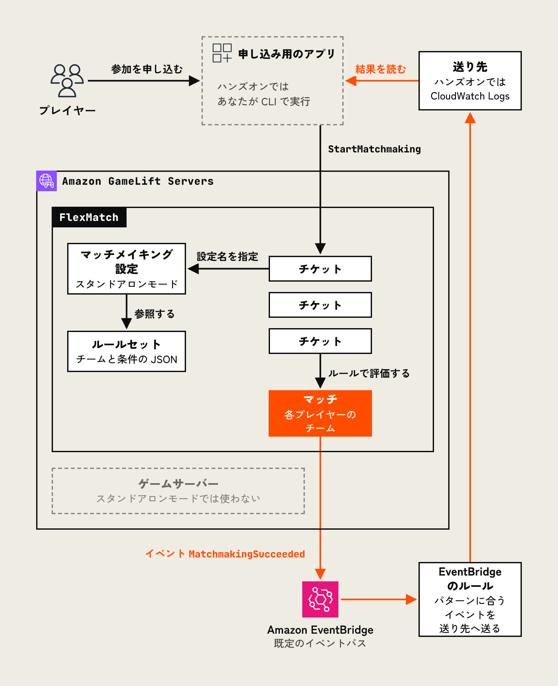
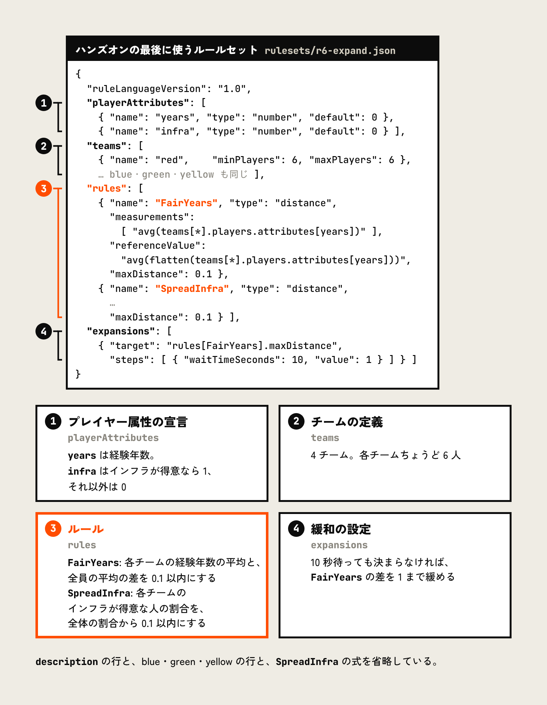
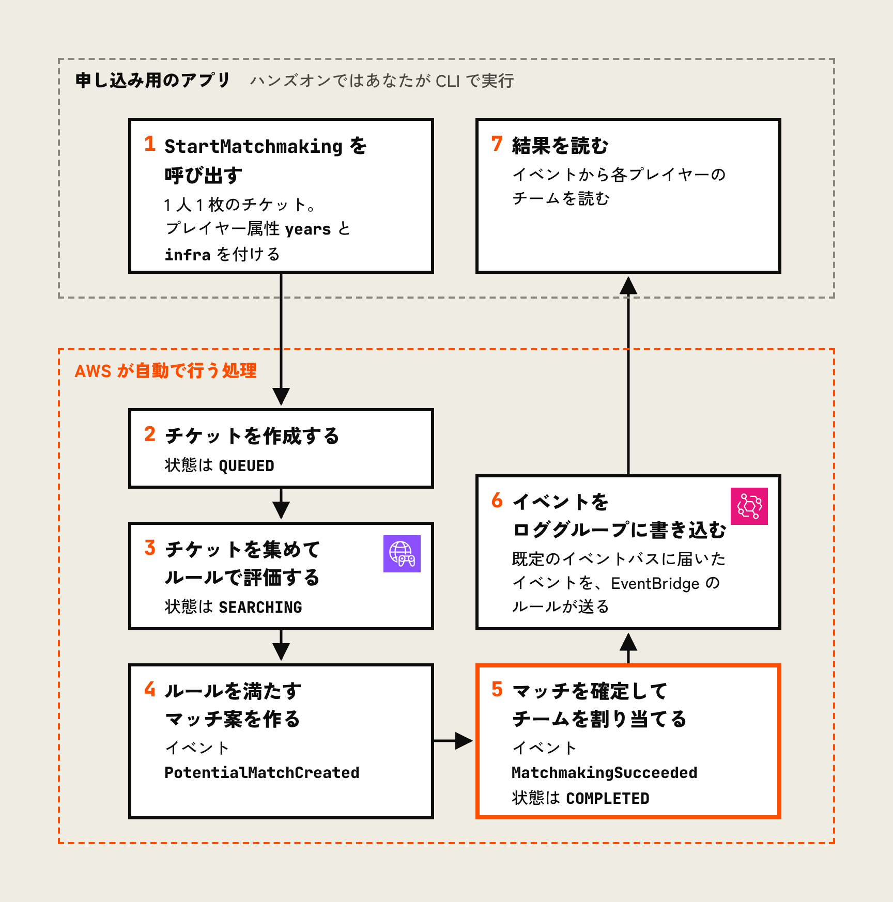
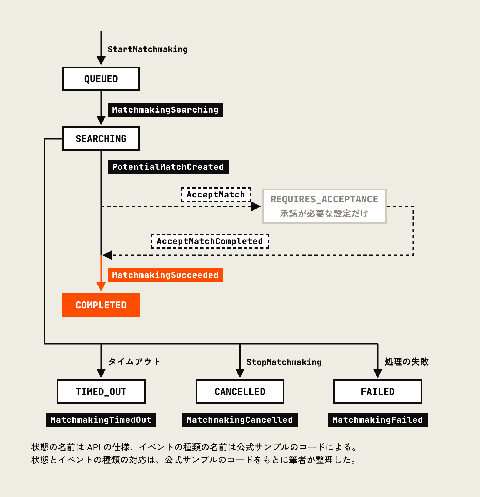
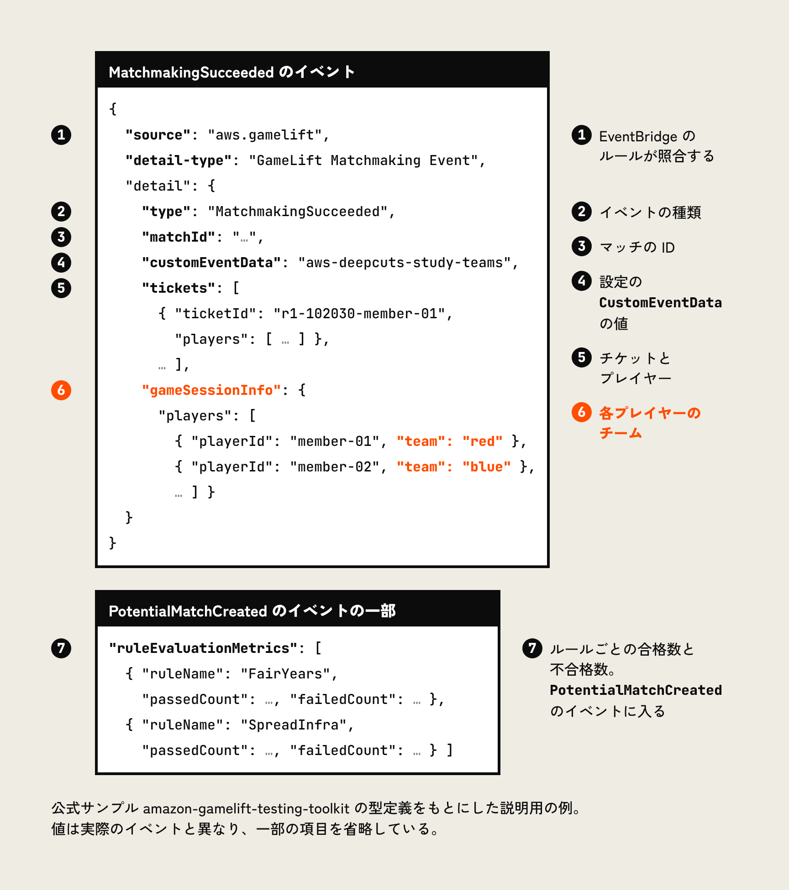
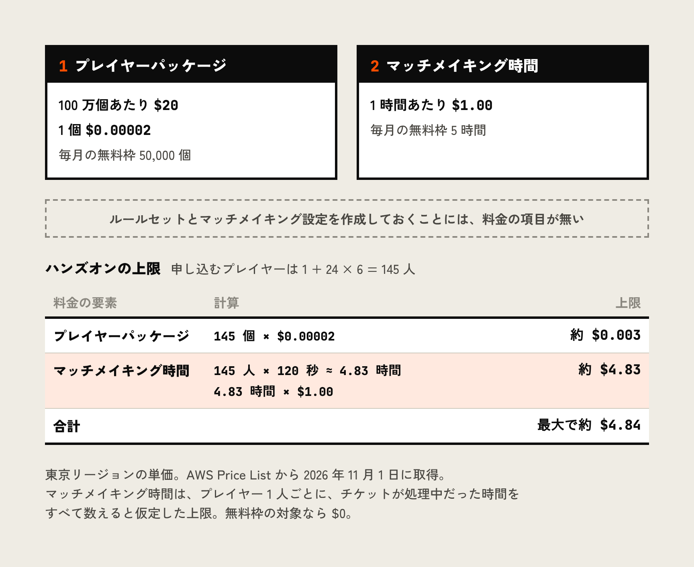
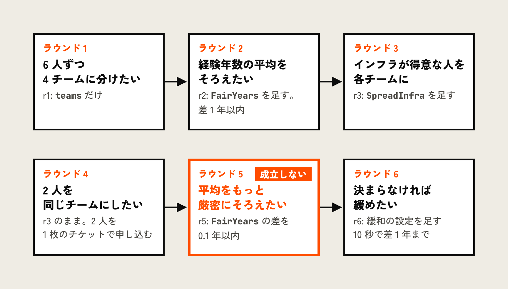
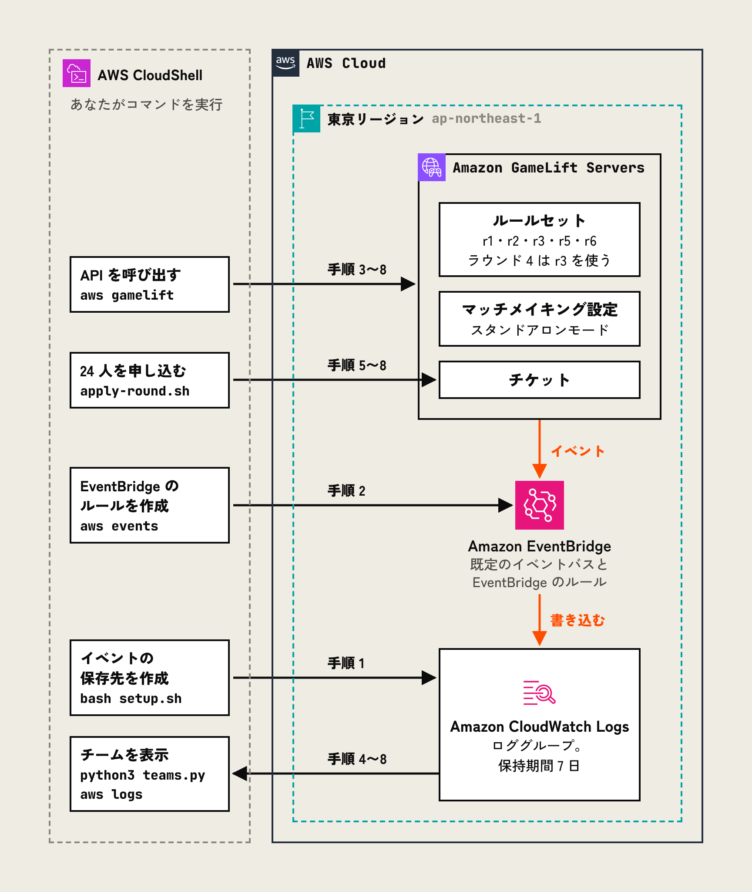

:::note info
AWS Deep Cuts の GitHub はこちらです。
https://github.com/AWS-Deep-Cuts/AWS-Deep-Cuts
:::

# AWS Deep Cutsとは？
AWS Deep Cutsは、AWS の最新のサービスやニッチな機能、または高度にアカデミックな知識を要求するサービスなど、多くの人が知らない 『隠れた名曲 = **Deep Cuts**』 を深くまで掘り下げる技術シリーズです。

このようなサービスはWeb情報も少なく、初学者は気軽にキャッチアップできないのが実情です。

そこで AWS Deep Cuts シリーズでは、**前提知識も含めた分かりやすいサービス解説** と **手順通りに進めれば誰でも再現できるハンズオン** を提供します！

# そもそもマッチメイキングとは？
新人研修やハッカソンで、参加者をいくつかのチームに分ける役を任されたことはありませんか？ チーム分けを担当する**幹事**は、名簿を見ながら各チームの人数をそろえ、経験の長い人が 1 つのチームに集まらないように、また得意分野が偏らないように考えて分けます。一緒に参加した 2 人を同じチームにしてほしい、と頼まれることもあります。

条件が 1 つなら、手で分けるのは難しくありません。しかし、条件が増えると事情が変わります。24 人を 6 人ずつ 4 チームに分ける分け方は、数えると約 962 億通りあります。経験年数をそろえるために 2 人を入れ替えた結果、今度は得意分野が偏る、ということもよく起こります。条件を増やしすぎると、いつまでも分け方が決まらないこともあります。

実は、これと同じ種類の問題は、オンラインの対戦ゲームでも起きています。対戦ゲームで「対戦相手を探す」を押すと、しばらくして同じくらいの腕前のプレイヤーが集まり、チームに分かれて対戦が始まります。このとき、ゲームのサーバーの側では、対戦を待っているプレイヤーの中から条件に合う人を選び、チームに分けています。この処理を**マッチメイキング**と呼びます。また、マッチメイキングの対象になる 1 人を**プレイヤー**と呼びます。

対戦ゲームでは、友人どうしで組んで一緒に対戦を申し込むこともあります。このように一緒に申し込むプレイヤーのまとまりを、**パーティー**と呼びます。幹事の要望と、対戦ゲームのマッチメイキングの条件を並べると、次のようになります。

| 幹事の要望 | 対戦ゲームのマッチメイキングの条件 |
| --- | --- |
| 各チームの人数をそろえる | 5 人対 5 人のように、チームの人数をそろえる |
| 経験の長さをチーム間でそろえる | チームごとの腕前の平均をそろえる |
| 得意分野が偏らないようにする | 各チームに、特定の役割のプレイヤーを入れる |
| 一緒に参加した 2 人を同じチームにする | 友人と組んだパーティーを同じチームにする |
| 条件が厳しすぎて決まらない事態を避ける | プレイヤーを待たせすぎない |

この記事では、AWS が公開している API の定義に書かれた各操作の説明を「API の説明文」、パラメータの型・必須かどうか・上限などの定義を「API の仕様」と呼びます。API の説明文も、マッチメイキングの条件の例として、各プレイヤーが一定の腕前を持つこと、各チームに特定の役割のプレイヤーが少なくとも 1 人いること、対戦する全員の腕前の平均が一定以上であることを挙げています。

表のとおり、幹事の要望は、対戦ゲームのマッチメイキングの条件とほぼ 1 対 1 に対応します。そこで筆者は、ゲームのために作られたマッチメイキングの仕組みを、勉強会のチーム分けにそのまま使えるのではないかと考えました。AWS には、このマッチメイキングだけを API で使えるサービスがあります。

# Amazon GameLift ServersのFlexMatchとは？
そのサービスが、Amazon GameLift Servers の FlexMatch です。まず、FlexMatch を含む Amazon GameLift Servers から説明します。

**Amazon GameLift Servers** は、セッション型のマルチプレイヤーゲームのサーバーを、クラウドで配置・運用・スケーリングする仕組みを提供するサービスです。セッション型のゲームとは、1 回の対戦ごとにプレイヤーが集まり、対戦が終わると解散するゲームのことです。API の説明文では、ゲームサーバーを動かすマネージドホスティングなど 4 つの形が紹介されており、FlexMatch もその 1 つです。

Amazon GameLift Servers は、2025 年 3 月に Amazon GameLift から名前が変わりました。AWS CLI の変更履歴でも、2025 年 3 月の版から新しい名前が使われています。ただし、API の名前は今も `gamelift` で、AWS CLI のコマンドは `aws gamelift` で始まります。以降、Amazon GameLift Servers を短く GameLift Servers と書きます。

**FlexMatch** は、API の説明文によると、マルチプレイヤーゲーム向けの、カスタマイズできるマッチメイキングのサービスです。GameLift Servers のマネージドホスティングと組み合わせて使うことも、自分で用意したホスティングの仕組みに単独のサービスとして組み込むこともできる、と説明されています。

GameLift Servers でゲームサーバーを動かす場合、1 回の対戦は、ゲームサーバーの上で動く**ゲームセッション**という処理になります。どのサーバーでゲームセッションを始めるかは、**ゲームセッションキュー**という仕組みが決めます。FlexMatch の 2 つの使い方は、このゲームセッションの開始まで FlexMatch に任せるかどうかで分かれます。

FlexMatch の使い方は、FlexMatch の設定の `FlexMatchMode` という項目の値で決まります。API の仕様では、値が `WITH_QUEUE` のとき、FlexMatch はプレイヤーの組み合わせを決めた後、指定されたゲームセッションキューを使ってゲームセッションを開始します。値が `STANDALONE` のとき、FlexMatch はプレイヤーの組み合わせを決め、プレイヤーとチームの割り当てを含む結果を、`MatchmakingSucceeded` という通知で返します。ゲームセッションを開始するのは、FlexMatch を使う側の仕事です。

`STANDALONE` を選んで FlexMatch だけを使う形を、**スタンドアロンモード**と呼びます。公式のリリースノートによると、スタンドアロンモードは 2020 年 11 月 24 日に公開されました。スタンドアロンモードを使うと、ゲームサーバーを 1 台も用意せずに、チーム分けの結果だけを受け取れます。勉強会のチーム分けに必要なのは、まさにこの結果です。

スタンドアロンモードの FlexMatch の全体像は、次の図のとおりです。この図はハンズオンと共通のため、図の「あなた」は、ハンズオンでコマンドを実行する読者を指します。図の上から順に、結果が届くまでの流れを説明します。



図の一番上のプレイヤーは、参加を申し込みます。申し込みを受けて FlexMatch の API を呼び出すプログラムを、この記事では**申し込み用のアプリ**と呼びます。ゲームでは、ゲームのバックエンドのサービスがこの役割を担います。ハンズオンでは、AWS CloudShell で実行する AWS CLI のコマンドとスクリプトが、申し込み用のアプリにあたります。AWS CloudShell は、ブラウザから AWS CLI のコマンドを実行できる環境です。

申し込み用のアプリは、`StartMatchmaking` API を呼び出して、プレイヤーを申し込みます。このとき、経験年数のようなプレイヤーごとの値を付けて申し込みます。この値を**プレイヤー属性**と呼びます。FlexMatch は、申し込みごとに**チケット**を作成します。チケットは、申し込みの内容と、その後の処理の状態を記録したものです。

申し込み用のアプリは、申し込むときに**マッチメイキング設定**の名前を指定します。マッチメイキング設定は、FlexMatch をどの条件でどのように動かすかをまとめた設定で、スタンドアロンモードを選ぶのもこの設定です。マッチメイキング設定は、**ルールセット**を参照します。ルールセットには、チームの数と人数、チーム分けの条件を JSON で書きます。

FlexMatch は、集まったチケットをルールセットの条件で評価し、条件を満たすプレイヤーの組み合わせと、各プレイヤーのチームの割り当てを決めます。この結果を**マッチ**と呼びます。

マッチの結果は、FlexMatch が発行する**イベント**として届きます。イベントは、チケットの状態が変わったことを知らせる JSON です。AWS は、FlexMatch のテストツール amazon-gamelift-testing-toolkit を GitHub で公開しています。この記事では、これを公式のテストツールと呼びます。この記事のハンズオンでは、公式のテストツールと同じく、イベントを **Amazon EventBridge** で受け取ります。

EventBridge は、AWS のサービスが発行したイベントを受け取り、条件に合うものを、指定した送り先に送るサービスです。AWS のサービスが発行したイベントは、まず EventBridge の**既定のイベントバス**に届きます。イベントの条件と送り先の組を、EventBridge のルールと呼びます。後で説明するルールセットの「ルール」と区別するため、この記事では、EventBridge のものを必ず「**EventBridge のルール**」と書きます。

EventBridge のルールがイベントを送る先を、**送り先**と呼びます。送り先は、EventBridge のルールを作成するときに指定します。ハンズオンでは、送り先に Amazon CloudWatch Logs のロググループを使います。申し込み用のアプリは、送り先からイベントを読み、各プレイヤーのチームを知ります。

:::note info
**スタンドアロンモードにフリートは要らない**
フリートは、ゲームサーバーを動かすインスタンスのまとまりです。API の説明文では、FlexMatch の操作の説明が「この API は EC2・Anywhere・Container のフリートで使える」という一文で始まります。これはフリートの種類についての注記で、スタンドアロンモードでフリートが必要になるという意味ではありません。
:::

Amazon GameLift Servers の FlexMatch のスタンドアロンモードには、以下のような特徴があります。

- **ゲームサーバーなしで使える**
  作成するのは、ルールセットとマッチメイキング設定の 2 つと、申し込みのたびに作られるチケットだけです。フリートやゲームセッションキューは作成しません。API の仕様では、FlexMatch の操作は `StartMatchmaking` や `CreateMatchmakingRuleSet` など 13 個です。
- **チーム分けの条件を JSON で書ける**
  ルールセットに、チームの人数や、チームごとの平均の差のような条件を書きます。書き方は、仕組みの章で説明します。
- **1 回の申し込みに最大 10 人を入れられる**
  API の仕様では、1 回の申し込みに最大 10 人のプレイヤーを入れられます。複数のプレイヤーを入れた申し込みは、同じチームに入れたいパーティーとして扱われます。
- **待ち時間に応じて条件を緩められる**
  ルールセットには、マッチが見つからないまま一定の時間がたつと、条件を緩める設定を書けます。API の説明文によると、この機能の目的は、最善のマッチを無期限に待たせるのではなく、適切な時間でプレイヤーをゲームに入れることです。
- **結果はイベントで届く**
  チームの割り当ては、イベントとして届きます。受け取り方は、メッセージを配信するサービスである Amazon SNS（Amazon Simple Notification Service）と、EventBridge の 2 つです。API の説明文は SNS を案内していますが、公式のテストツールは EventBridge を使っています。この記事のハンズオンも、EventBridge でイベントを受け取り、ロググループに保存します。
- **料金はプレイヤーの数と処理の時間で決まる**
  東京リージョンの単価は、プレイヤーパッケージ 100 万個あたり $20 と、マッチメイキング 1 時間あたり $1.00 です。単位の意味と計算の例は、仕組みの章の料金の節で説明します。
- **東京リージョンの料金が公開されている**
  AWS の価格表である AWS Price List では、スタンドアロンモードの料金は東京を含む 7 つのリージョンで公開されています。大阪リージョンの料金はありません。東京リージョンで実際に作成できることは、ハンズオンの手順の中で確かめます。<!-- 要確認: C1 東京リージョンで、ルールセットとスタンドアロンモードのマッチメイキング設定を作成できること -->

# 仕組み
前の章の全体像の図に沿って、ルールセット・マッチメイキング設定・1 回の申し込み・結果のイベント・料金の順に、それぞれで何が起きるのかを説明します。各節で説明することと、申し込み用のアプリが呼び出す API は、次のとおりです。

| 節 | 申し込み用のアプリが呼び出す API | 説明すること |
| --- | --- | --- |
| ルールセット | `ValidateMatchmakingRuleSet`・`CreateMatchmakingRuleSet` | チームと条件の書き方 |
| マッチメイキング設定 | `CreateMatchmakingConfiguration`・`UpdateMatchmakingConfiguration` | スタンドアロンモードとタイムアウト |
| 1 回のマッチメイキングで起きること | `StartMatchmaking`・`StopMatchmaking`・`DescribeMatchmaking` | チケットの状態とイベントの種類 |
| 結果を受け取るイベント | なし | EventBridge で受け取るイベントの中身 |
| 料金 | なし | 料金の要素と計算の例 |

この章の図もハンズオンと共通で、図の「あなた」は、申し込み用のアプリを操作する人を指します。

## ルールセット
最初に、チーム分けの条件を書くルールセットを説明します。API の説明文によると、ルールセットは次の 4 つの部分からなります。

| 部分 | 必須か | 書くこと |
| --- | --- | --- |
| `playerAttributes` | 任意 | ルールで使うプレイヤー属性の宣言 |
| `teams` | 必須 | 1 つ以上のチームと、各チームの最小と最大の人数 |
| `rules` | 任意 | チーム分けの条件 |
| `expansions` | 任意 | マッチが見つからないまま一定の時間がたったときに、条件を緩める設定 |

次の図は、ハンズオンの最後に使うルールセット `rulesets/r6-expand.json` で、4 つの部分を示したものです。図の ①〜④ と、この後の説明の ①〜④ は対応しています。



① の `playerAttributes` では、ルールで使うプレイヤー属性を宣言します。AWS は、公式のテストツールのほかにも、FlexMatch のサンプルやツールのコードを GitHub で公開しています。この記事では、これらをまとめて**公式サンプル**と呼びます。公式サンプルのルールセットでは、属性ごとに名前・型・既定値を書いています。ハンズオンでは、経験年数を表す `years` と、インフラが得意な人は 1 でそれ以外の人は 0 になる `infra` を、どちらも数値として宣言します。

② の `teams` では、チームを定義します。ハンズオンでは red・blue・green・yellow の 4 チームを定義し、各チームの最小の人数 `minPlayers` と最大の人数 `maxPlayers` を、どちらも 6 にしています。つまり、各チームはちょうど 6 人です。

③ の `rules` には、チーム分けの条件を書きます。1 つの条件を**ルール**と呼びます。この記事で単に「ルール」と書くときは、ルールセットの中の条件を指します。

図の `FairYears` は、各チームの経験年数の平均を、全員の平均に近づけるルールです。ルールの種類は `distance` で、`measurements` に書いた値と `referenceValue` に書いた値の差を、`maxDistance` 以内にすることを求めます。公式サンプルの 2 つのルールセットも、チームの腕前の平均をそろえるために、同じ形の `distance` ルールを使っています。

`measurements` と `referenceValue` に書いた `avg(teams[*].players.attributes[years])` のような式を、**プロパティ式**と呼びます。プロパティ式は、次のように読みます。

- `teams[*]` は、すべてのチームを表します。
- `teams[*].players.attributes[years]` は、各チームのプレイヤーの `years` の値です。
- `avg(...)` は平均を求めます。`measurements` の `avg(teams[*].players.attributes[years])` は、チームごとの平均です。4 チームなら 4 つの値になります。
- `flatten(...)` は、全チームのプレイヤーの値を 1 つにまとめます。`referenceValue` の `avg(flatten(...))` は、マッチ全体の平均です。

つまり `FairYears` は、4 チームそれぞれの経験年数の平均と、24 人全員の平均との差を、どれも `maxDistance` 以内にするルールです。図のルールセットでは、この差を 0.1 年以内にしています。

`SpreadInfra` は、同じ `distance` ルールを `infra` に使ったものです。`infra` は 1 か 0 のため、チームの `infra` の平均は、そのチームの中のインフラが得意な人の割合になります。ハンズオンの参加者 24 人のうち、インフラが得意な人は 6 人で、全体の割合は 0.25 です。差を 0.1 以内にすると、6 人のチームでは、インフラが得意な人は 1 人か 2 人になります。1 人なら割合は約 0.17、2 人なら約 0.33 で、どちらも 0.25 との差が約 0.08 だからです。0 人と 3 人では、差が 0.25 になり、条件を満たしません。

④ の `expansions` は、待ち時間に応じてルールの値を緩める設定です。この記事では、これを**緩和の設定**と呼びます。図の緩和の設定は、10 秒待ってもマッチが決まらなければ、`FairYears` の `maxDistance` を 0.1 から 1 に緩めます。

待ち時間をどのチケットの待ち時間で数えるかは、ルールセットの `algorithm` という項目の中の `expansionAgeSelection` で決まります。公式サンプルには、ルールセットを読み込んで図で表示する sample-visualization-of-flexmatch-rule があります。この記事では、これを公式の可視化ツールと呼びます。公式の可視化ツールは、`expansionAgeSelection` を省略したときの値を `newest` と表示します。筆者は、`newest` を、マッチの候補に含まれるチケットのうち、最も新しいチケットの待ち時間で数える設定だと理解しています。この理解が正しければ、24 人を順に申し込む場合、緩和の設定は、最後の 1 人を申し込んでから 10 秒たつまで効かない見込みです。<!-- 要確認: C21 expansionAgeSelection の newest の意味と、緩和が最後の申し込みから 10 秒たつまで効かないこと -->

ハンズオンで使うルールの種類は `distance` だけですが、ルールの種類は他にもあります。公式の可視化ツールの型定義によると、ルールの種類は次の 8 つです。表の「できること」は、公式サンプルと公式のリリースノートの記述をもとにしています。

| 種類 | できること |
| --- | --- |
| `distance` | 数値の差を一定以内にする。チームの平均を全体の平均にそろえる |
| `comparison` | 2 つの値を比べる。公式サンプルでは、`count` で数えた 2 つのチームの人数を等しくしている |
| `collection` | 集合の要素の数を数える。公式サンプルでは、ある値を選んだプレイヤーの数を、マッチ全体で一定の範囲に収めている |
| `compound` | 名前を付けた他のルールを and・or・not・xor で組み合わせる。40 人以下のマッチだけで使える |
| `latency` | プレイヤーと AWS のリージョンの間の通信の遅れであるレイテンシを条件にする |
| `batchDistance` | 40 人を超えるマッチで、スキル・モード・マップをもとにプレイヤーをそろえる |
| `distanceSort`・`absoluteSort` | 型定義に名前がある。この記事では扱わない |

`latency` ルールには注意が必要です。API の説明文によると、レイテンシを評価するルールがある場合、レイテンシを報告しないプレイヤーのチケットはマッチできません。勉強会のチーム分けでは通信の遅れを考える必要が無いため、`latency` ルールは使いません。

ルールセットには、もう 1 つ大事な性質があります。API の説明文によると、ルールセットは作成した後に編集できません。そのため、作成する前に `ValidateMatchmakingRuleSet` API で構文を確かめるよう勧めています。この API は、ルールセットが正しい JSON で書かれ、許されたプロパティ式に沿っているかを検査し、結果を真偽値の `Valid` で返します。ルールセットの本文は、最大 65,535 文字の JSON です。JSON にはコメントを書けませんが、多くの要素に `description` を書けます。

:::note info
**40 人を超えるマッチ**
40 人を超えるマッチを、**ラージマッチ**と呼びます。AWS の文書によると、ラージマッチで使えるルールは `latency` と `batchDistance` だけです。また、AWS の製品ページによると、1 つのマッチには最大 200 人を入れられます。公式の可視化ツールのコードでは、ラージマッチかどうかを決める人数は、全チームについて `maxPlayers` と `quantity` を掛けた値の合計です。`quantity` は、同じ定義のチームを複数作るための項目です。公式の可視化ツールは、この合計が 40 以下かどうかで、すべてのルールを使えるかを表示します。勉強会のチーム分けを 40 人以下に収めれば、すべてのルールを使えます。
:::

## マッチメイキング設定
ルールセットは、作成しただけでは使われません。マッチメイキング設定から参照されて、初めてチーム分けに使われます。申し込み用のアプリは、このマッチメイキング設定の名前を指定して申し込みます。ハンズオンで `CreateMatchmakingConfiguration` API に指定するパラメータは、次のとおりです。

| パラメータ | ハンズオンの値 | 意味 |
| --- | --- | --- |
| `Name` | `aws-deepcuts-study-teams` | 設定の名前。英数字・ハイフン・ピリオドで 128 文字まで |
| `RuleSetName` | `aws-deepcuts-teams-r1` など | 使うルールセットの名前 |
| `FlexMatchMode` | `STANDALONE` | スタンドアロンモードを選ぶ |
| `RequestTimeoutSeconds` | `120` | チケットが処理中のままでいられる最長の秒数。1〜43,200 秒で指定する |
| `AcceptanceRequired` | `false` | 決まったマッチを、プレイヤーが承諾する必要があるか |
| `CustomEventData` | `aws-deepcuts-study-teams` | この設定に関するすべてのイベントに付く文字列。256 文字まで |
| `NotificationTarget` | 指定しない | 通知先の SNS のトピックの ARN |

API の仕様では、必須のパラメータは `Name`・`RequestTimeoutSeconds`・`AcceptanceRequired`・`RuleSetName` の 4 つです。`FlexMatchMode` は必須ではありませんが、省いたときの既定値は API の仕様に書かれていません。そのため、ハンズオンでは必ず `STANDALONE` を指定します。

`RequestTimeoutSeconds` は、API の説明文によると、チケットがタイムアウトするまでに処理中のままでいられる最長の秒数です。この記事では、この秒数を**申し込みのタイムアウト**と呼びます。ハンズオンでは 120 秒にしています。

`AcceptanceRequired` は、**承諾**の手続きを使うかどうかを決めます。承諾は、FlexMatch が作ったマッチをプレイヤーが受け入れるかを確かめる手続きです。API の仕様では、承諾が必要な設定のチケットは `REQUIRES_ACCEPTANCE` という状態になり、申し込み用のアプリが `AcceptMatch` API でプレイヤーの返事を伝えます。スタンドアロンモードでも `AcceptanceRequired` は必須のパラメータで、承諾の手続きも使えます。公式サンプルの 1 つで、スタンドアロンモードのマッチメイキングを模擬するシミュレーターは、承諾が必要な設定を使っています。勉強会のチーム分けでは承諾を使わないため、ハンズオンでは `false` にします。

一方、スタンドアロンモードでは使わないパラメータもあります。API の仕様では、スタンドアロンモードでは `GameSessionQueueArns` を設定してはいけません。また、`AdditionalPlayerCount`・`GameProperties`・`GameSessionData` は使われず、自動のバックフィルも使えません。バックフィルは、進行中のマッチに後からプレイヤーを足す仕組みです。

マッチメイキング設定は、作成した後も `UpdateMatchmakingConfiguration` API で変更できます。API の説明文によると、変更は更新の後に作られるマッチにだけ効きます。前の節で説明したとおり、ルールセットは編集できません。そのため、ルールを変えるときは、新しいルールセットを作成し、マッチメイキング設定の `RuleSetName` を差し替えます。公式のシミュレーターも、この手順でルールセットを差し替えています。ハンズオンでも、この手順を繰り返して、ルールを 1 つずつ足していきます。

## 1 回のマッチメイキングで起きること
マッチメイキング設定とルールセットがそろったら、申し込み用のアプリがプレイヤーを申し込みます。次の図は、1 回の申し込みで、誰が何をし、どの順で何が起きるのかを示しています。図の 1 と 7 は申し込み用のアプリが行う操作で、2〜6 は AWS が自動で行う処理です。



1. 申し込み用のアプリが、`StartMatchmaking` API を呼び出します。ハンズオンでは、参加者 1 人を 1 枚のチケットで申し込み、プレイヤー属性 `years` と `infra` を付けます。
2. FlexMatch が、チケットを作成します。チケットの状態は `QUEUED` です。
3. FlexMatch が、チケットを集めてルールで評価します。チケットの状態は `SEARCHING` です。
4. FlexMatch が、ルールを満たすプレイヤーの組み合わせの候補を作り、`PotentialMatchCreated` のイベントを発行します。この候補を**マッチ案**と呼びます。
5. FlexMatch が、マッチを確定して各プレイヤーにチームを割り当て、`MatchmakingSucceeded` のイベントを発行します。チケットの状態は `COMPLETED` になります。
6. 既定のイベントバスに届いたイベントを、EventBridge のルールがロググループに書き込みます。
7. 申し込み用のアプリが、イベントから各プレイヤーのチームを読みます。

図の 1 の `StartMatchmaking` で必須なのは、マッチメイキング設定の名前とプレイヤーの一覧です。API の仕様では、チケットの ID を省くと、FlexMatch が UUID（Universally Unique Identifier）を付けます。申し込みに成功すると、状態が `QUEUED` のチケットが返ります。ハンズオンで 1 人を申し込むコマンドは、次のとおりです。`${REGION}` などの変数は、ハンズオンの手順の中で設定します。

```bash
aws gamelift start-matchmaking \
  --region "${REGION}" \
  --configuration-name "${CONFIG_NAME}" \
  --ticket-id "${TRIAL_TICKET}" \
  --players '[{"PlayerId": "member-01", "PlayerAttributes": {"years": {"N": 1}, "infra": {"N": 0}}}]'
```

プレイヤー属性のキーは、ルールセットの `playerAttributes` と一致させます。API の仕様では、ルールセットが求めるプレイヤー属性は必ず渡す必要があり、1 人に付けられる属性は最大 10 個です。属性の値の型は、文字列の `S`・数値の `N`・文字列のリストの `SL`・文字列から数値へのマップの `SDM` の 4 つです。上のコマンドでは、`years` と `infra` を数値の `N` で渡しています。

`PlayerId` は 1〜1,024 文字のプレイヤーの ID で、API の仕様では機微情報として扱われています。そのため、ハンズオンでは実在の人の名前ではなく、`member-01` のような架空の ID を使います。

1 枚のチケットに複数のプレイヤーを入れることもできます。API の説明文によると、その場合、FlexMatch はチケットの全員を同じチームに入れたマッチを作ろうとします。つまり、1 人 1 枚で申し込めば、誰と誰を組ませるかを FlexMatch に任せられます。同じチームにしたい 2 人は、1 枚のチケットにまとめて申し込みます。

申し込んだチケットの状態は、処理が進むにつれて変わります。API の仕様では、チケットの状態は 8 種類です。状態が変わると、FlexMatch はイベントを発行します。ただし、イベントの種類の名前は、チケットの状態の名前と異なります。たとえば、マッチが成立したチケットの状態は `COMPLETED` ですが、届くイベントの種類は `MatchmakingSucceeded` です。チケットの状態と、状態が変わるところで届くイベントの種類は、次の図のとおりです。



公式のテストツールのコードでは、イベントの種類は 8 つです。チケットの状態の変化と、そのときに届くイベントの種類を、公式サンプルのコードをもとに筆者が対応づけると、次の表のようになります。

| チケットの状態の変化 | 変化の意味 | 届くイベントの種類 |
| --- | --- | --- |
| なし → `QUEUED` | 申し込みを受け付けた | なし |
| `QUEUED` → `SEARCHING` | マッチを探し始めた | `MatchmakingSearching` |
| `SEARCHING` から次の状態へ | ルールを満たすマッチ案ができた | `PotentialMatchCreated` |
| → `REQUIRES_ACCEPTANCE` → `COMPLETED` | 承諾が必要な設定だけ。プレイヤーの承諾を待ち、全員が承諾した | `AcceptMatch`・`AcceptMatchCompleted` |
| → `COMPLETED` | マッチが成立した | `MatchmakingSucceeded` |
| `SEARCHING` などの処理中 → `TIMED_OUT` | 申し込みのタイムアウトを過ぎた | `MatchmakingTimedOut` |
| 処理中 → `CANCELLED` | `StopMatchmaking` で止めた | `MatchmakingCancelled` |
| 処理中 → `FAILED` | 処理に失敗した | `MatchmakingFailed` |

`PotentialMatchCreated` は、マッチが成立した後ではなく、マッチ案ができた時点で届きます。承諾が不要な設定では、その後に `MatchmakingSucceeded` が届く見込みです。<!-- 要確認: C6 スタンドアロンモードで届くイベントの種類と順序 -->

API の仕様には、ゲームセッションの配置中を表す `PLACING` という状態もあります。ただし、この状態の説明はゲームセッションを前提にした文面で、スタンドアロンモードのチケットが `PLACING` を通るかは、公式の資料からは分かりませんでした。そのため、図には `PLACING` を描いていません。<!-- 要確認: C7 スタンドアロンモードのチケットが PLACING を通るか -->

マッチが成立したチケットの状態は `COMPLETED` です。公式のシミュレーターも、`COMPLETED` になったチケットを成功として数えています。API の仕様では、`COMPLETED` のチケットの各プレイヤーには、割り当てられたチームの名前が入ります。チームの名前は、ルールセットで定義した名前です。

処理中のチケットは、`StopMatchmaking` API で止められます。API の仕様では、止めたチケットの状態は `CANCELLED` になります。

チケットの状態は、`DescribeMatchmaking` API でも取得できます。ただし、API の説明文によると、この API は一度に最大 10 件のチケットを取得するもので、状態を追うために繰り返し呼び出す設計ではありません。繰り返し呼び出すと、API の呼び出しの上限を超えてエラーになるおそれがあります。そのため、チケットの状態は、次の節で説明するイベントで受け取ります。

:::note info
**FlexMatch はどのようにチームを組み立てるのか**
AWS の FlexMatch 開発者ガイドの説明によると、FlexMatch は、待っているチケットの中で最も古いチケットを起点に候補のチケットを 1 枚ずつ加えてルールで評価し、ルールを満たせばチームに割り当てる手順を繰り返します。筆者は、この説明から、FlexMatch はすべての分け方の中から最も良いものを探すのではなく、ルールを満たす分け方を 1 つ見つける仕組みだと理解しています。
<!-- 要確認: C19 開発者ガイドの「FlexMatch の仕組み（How Amazon GameLift Servers FlexMatch works）」の原文で、この手順の説明を確かめる -->
:::

## 結果を受け取るイベント
前の節で説明したとおり、チケットの状態はイベントで受け取ります。受け取り方は 2 つあります。

- API の説明文は、マッチメイキング設定の `NotificationTarget` に指定した SNS のトピックで、チケットの状態を追うよう案内しています。トピックは、SNS でメッセージを発行する先です。
- 公式のテストツールは、`NotificationTarget` を指定しないスタンドアロンモードの設定を作成し、イベントを EventBridge で受け取っています。

ハンズオンでは、後者の EventBridge を使います。EventBridge・既定のイベントバス・EventBridge のルールは、全体像の図で説明しました。ここでは、EventBridge のルールの条件を書いた JSON を、**イベントパターン**と呼びます。

公式のテストツールのコードでは、FlexMatch のイベントは既定のイベントバスに、`source` が `aws.gamelift`、`detail-type` が `GameLift Matchmaking Event` で届きます。ハンズオンでは、公式のテストツールと同じ条件の、次のイベントパターンを使います。ファイルは `hands-on/event-pattern.json` です。

```json
{
  "source": ["aws.gamelift"],
  "detail-type": ["GameLift Matchmaking Event"]
}
```

このイベントパターンを持つ EventBridge のルールを、ハンズオンでは AWS CLI の `aws events put-rule` コマンドで作成し、送り先にロググループを指定します。CloudWatch Logs は、ログを保存するサービスです。ロググループは、CloudWatch Logs でログをまとめて保存する単位です。

次の図は、`MatchmakingSucceeded` のイベントのどこに、各プレイヤーのチームが入っているかを示しています。図の値は、公式のテストツールの型定義をもとにした説明用の例です。



チームの割り当ては、⑥ の `detail.gameSessionInfo.players[]` の `team` に入ります。公式のテストツールは、スタンドアロンモードの設定のイベントから、この項目を各プレイヤーのチームとして読んでいます。ゲームサーバーが無いため、ゲームセッションの接続先を表す `ipAddress` と `port` は入らない見込みです。④ には、マッチメイキング設定の `CustomEventData` に指定した文字列が入ります。API の説明文によると、この文字列は、その設定に関するすべてのイベントに付きます。そのため、複数のマッチメイキング設定を使う場合も、どの設定のイベントかを見分けられます。

⑦ の `ruleEvaluationMetrics` を見ると、どのルールで何回、候補が条件を満たさなかったかを確かめられます。⑦ は、`PotentialMatchCreated` のイベントに入る項目です。公式のテストツールは、`PotentialMatchCreated` のイベントの `detail.ruleEvaluationMetrics` を、マッチの結果として保存しています。各要素には、ルールの名前の `ruleName`、合格数の `passedCount`、不合格数の `failedCount` が入ります。この記事では、これを**ルールごとの合格数と不合格数**と呼びます。ハンズオンでは、緩和の設定を使うルールセットで、実物を確認します。<!-- 要確認: C6 スタンドアロンモードの PotentialMatchCreated に ruleEvaluationMetrics が入ること。MatchmakingSucceeded の gameSessionInfo.players[].team の形 -->

:::note info
**SNS で受け取る場合**
公式サンプルのコードでは、SNS で届くメッセージの本文は、EventBridge で届くイベントと同じ形の JSON として読まれています。また、公式サンプルのコードでは、トピックのアクセスポリシーで、サービスプリンシパル `gamelift.amazonaws.com` に `sns:Publish` を許可しています。どちらも API の仕様には書かれていません。API の仕様では、通知先には FIFO トピックも指定できます。ただし、AWS の文書によると、大量のマッチメイキングでは、FIFO トピックではなく標準のトピックが勧められています。
:::

## 料金
最後に、ここまでに出てきた操作のうち、料金がかかるものを説明します。単価は AWS Price List の東京リージョンの値で、2026 年 11 月 1 日に取得しました。価格表の版の公開日は、2026 年 10 月 13 日です。



| 料金の要素 | 東京リージョンの単価 | 毎月の無料枠 |
| --- | --- | --- |
| ① プレイヤーパッケージ | 100 万個あたり $20。1 個 $0.00002 | 50,000 個 |
| ② マッチメイキング時間 | 1 時間あたり $1.00 | 5 時間 |

表の無料枠は、Price List に項目があるものです。ただし、無料枠が 12 か月に限られるのかずっと続くのか、どの種類のアカウントに適用されるのかは、Price List からは分かりません。また、AWS が AI エージェント向けにサービスの使い方をまとめて公開している Agent Skill によると、2025 年 7 月 15 日以降に作成したアカウントでは、無料利用枠が最大 $200 のクレジットの方式に変わっています。そのため、表の FlexMatch の無料枠が、2025 年 7 月 15 日以降に作成したアカウントにも適用されるかは分かりません。

ルールセットとマッチメイキング設定を作成しておくことには、Price List に料金の項目がありません。FlexMatch の料金の項目は、スタンドアロンモードの 2 つだけです。AWS の文書によると、GameLift Servers のマネージドホスティングと組み合わせて使う FlexMatch の料金は、ホスティングの料金に含まれます。

2 つの単位の正確な定義は、公式の資料で確かめられませんでした。AWS の料金ページの計算例では、プレイヤーパッケージの数を 1 マッチの人数で割って、マッチの数を求めています。そのため、筆者は、1 回の申し込みに含まれるプレイヤー 1 人が、1 個のプレイヤーパッケージにあたると読んでいます。<!-- 要確認: C19 料金ページの計算例の原文 --> マッチメイキング時間は、AWS の文書によると、申し込みを評価してマッチを提案する処理の時間です。この記事では、費用の上限を求めるため、チケットに含まれるプレイヤー 1 人ごとに、チケットが処理中だった時間をすべて数えると仮定します。チケット 1 枚ごとに数えるよりも大きくなる、上限側の仮定です。<!-- 要確認: C14 翌日以降の請求の usage type と量 -->

ハンズオンでは、試しに 1 人を申し込んだ後、24 人の申し込みを 6 回繰り返します。そのうち 4 回は、ルールセットを差し替えてから申し込みます。申し込むプレイヤーは、合わせて 1 + 24 × 6 = 145 人です。各チケットが申し込みのタイムアウトの 120 秒まで処理中だったとすると、費用の上限は次のとおりです。

| 料金の要素 | 計算 | 上限 |
| --- | --- | --- |
| プレイヤーパッケージ | 145 個 × $0.00002 | 約 $0.003 |
| マッチメイキング時間 | 145 人 × 120 秒 = 17,400 秒 ≈ 4.83 時間、4.83 時間 × $1.00 | 約 $4.83 |
| 合計 | | 最大で約 $4.84 |

無料枠の対象であれば、4.83 時間も 145 個も無料枠の範囲に収まるため、$0 です。このほかに、イベントを保存する CloudWatch Logs の料金と、ログをクエリで検索する CloudWatch Logs Insights の料金がかかります。ハンズオンのイベントも、クエリで読むデータも 1 MB 未満の見込みで、合わせて 1 セント未満の見込みです。<!-- 要確認: CloudWatch Logs Insights の東京リージョンの単価。読んだデータ 1 GB あたりの値を Price List の AmazonCloudWatch で確かめる --> EventBridge の Price List には、同じアカウントの AWS のサービスのイベントを既定のイベントバスで受け取ることへの料金の項目がありません。

満たせる分け方が存在しないルールで申し込んだチケットは、マッチが決まらないまま、申し込みのタイムアウトまで処理中のまま残る見込みです。上の上限の見積もりでは、この時間も数えています。ハンズオンでは、その様子を実際に確かめます。

# Amazon GameLift ServersのFlexMatchの主な活用事例
ここまでで、FlexMatch がルールセットに沿ってプレイヤーをチームに分け、結果をイベントで返すことを見てきました。この仕組みを生かせる場面を、AWS の API の説明文・公式のリリースノート・AWS の Q&A のコミュニティである re:Post の回答をもとに、筆者が整理しました。

- **マネージドホスティングのゲームのマッチメイキング**
  `FlexMatchMode` を `WITH_QUEUE` にすると、FlexMatch が作ったマッチから、ゲームセッションキューを使ってゲームセッションが開始されます。GameLift Servers でゲームサーバーを動かすゲームの、標準的な使い方です。
- **自前のサーバーやピアツーピアのゲームのマッチメイキング**
  公式のリリースノートによると、スタンドアロンモードは、ピアツーピア・自社のオンプレミスの計算資源・クラウドの計算資源で動くゲームにも組み込めます。ピアツーピアは、プレイヤーの端末どうしが直接通信する方式です。
- **ゲーム以外の人の組み合わせ**
  勉強会・ハッカソン・研修のチーム分けに使えると、筆者は考えます。re:Post には、チャットアプリで興味の近い人どうしを組み合わせるために FlexMatch を使えるか、という質問があります。この質問には、スタンドアロンモードの FlexMatch は単独で使えるため、ゲーム以外にも使える、という回答が付いています。同じスレッドには、利用者が少なく条件が細かいと、費用が高くなりうるという指摘もあります。

# Amazon GameLift ServersのFlexMatchを使う際のベストプラクティス
ここまでの仕組みを踏まえて、FlexMatch を使うときに守りたいことを 6 つ挙げます。API の説明文や公式サンプルに基づく項目には、その出典を書いています。それ以外の項目は、筆者の考えです。

- **ルールセットは作成する前に検査する**
  API の説明文によると、ルールセットは作成した後に編集できません。作成する前に `ValidateMatchmakingRuleSet` で検査します。ただし、この検査が確かめるのは、JSON の構文とプロパティ式の形です。
- **ルールを変えるときは新しいルールセットに差し替える**
  新しいルールセットを作成し、`UpdateMatchmakingConfiguration` でマッチメイキング設定の `RuleSetName` を差し替えます。公式のシミュレーターも、この手順を使っています。API の説明文によると、古いルールセットは、どのマッチメイキング設定にも使われていなければ削除できます。ルールセットを作りすぎると、API の仕様では、作成の操作が `LimitExceededException` を返します。
- **チケットの状態はイベントで受け取る**
  API の説明文によると、`DescribeMatchmaking` は、状態を追うために繰り返し呼び出す設計ではありません。状態は、SNS の通知か EventBridge のイベントで受け取ります。
- **申し込みのタイムアウトと緩和の設定を組み合わせる**
  API の説明文は、緩和の設定を、プレイヤーを無期限に待たせないための機能と説明しています。筆者の考えでは、満たせる分け方が存在しないルールでもルールセットの検査は通り、チケットは申し込みのタイムアウトまで探し続ける見込みです。その間の時間も、マッチメイキング時間に数えられる可能性があります。料金の節の上限の見積もりでも、満たせないルールで申し込む 1 回分の 24 人 × 120 秒 = 0.8 時間を数えています。<!-- 要確認: ハンズオンの 5 回目の申し込みの実機の結果 -->
- **プレイヤー ID と属性に個人の情報を入れない**
  API の仕様では、プレイヤー ID は機微情報として扱われます。筆者は、人の組み合わせに使うときも、実名ではなく架空の ID を使い、プレイヤー属性にはルールで使う値だけを渡すことを勧めます。
- **公式のツールでルールセットを試す**
  公式の可視化ツールは、ルールセットを図で表示し、40 人以下かどうかも表示します。日本語の README もあります。公式のテストツールでは、仮想のプレイヤーを起動して、ルールセットを試せます。ただし、第三者の記事によると、公式のテストツールを配置すると、NAT ゲートウェイと AWS Fargate の料金がかかります。

# ハンズオンはこちら！
ここまでに説明した仕組みは、ハンズオンで実際に確かめられます。ハンズオンでは、CloudShell で AWS CLI のコマンドを 1 つずつ実行し、ルールセット・マッチメイキング設定・EventBridge のルールを作成します。そのうえで、架空の勉強会の参加者 24 人を、FlexMatch のスタンドアロンモードで 6 人ずつ 4 チームに分けます。

ルールセットを 1 つ選んで 24 人全員を申し込み、結果を受け取るまでを、**ラウンド**と呼びます。ハンズオンでは、幹事の要望をラウンドごとに 1 つずつルールセットに足していきます。6 回のラウンドの流れは、次の図のとおりです。



ラウンド 5 では、条件を満たす分け方が存在しないため、マッチは成立しません。なぜ存在しないのかは、ハンズオンで参加者の名簿を確認しながら考えてみてください。

ハンズオンの構成は、次の図のとおりです。図の「手順 3〜8」などの番号は、ハンズオンの手順の番号です。ハンズオンで作成するのは、ルールセット・マッチメイキング設定・EventBridge のルール・CloudWatch Logs のロググループなどです。ゲームサーバー・フリート・IAM ロールは作成しません。



https://github.com/AWS-Deep-Cuts/amazon-gamelift-servers

# まとめ
Amazon GameLift Servers の FlexMatch のスタンドアロンモードを使うと、ゲームサーバーを用意せずに、ルールセットに沿ったチーム分けの結果だけを受け取れます。冒頭の幹事の要望と、それを実現する FlexMatch の仕組みと、ハンズオンで確かめるラウンドは、次のとおりです。

| 幹事の要望 | FlexMatch の仕組み | ラウンド |
| --- | --- | --- |
| 6 人ずつ 4 チームに分ける | ルールセットの `teams` | 1 |
| 経験年数の平均をそろえる | `distance` ルールと `avg` のプロパティ式 | 2 |
| インフラが得意な人を各チームに入れる | 1 か 0 の属性に `distance` ルールを使う | 3 |
| 2 人を同じチームにする | 2 人を 1 枚のチケットで申し込む | 4 |
| 条件が厳しすぎて決まらない事態を避ける | 申し込みのタイムアウトと緩和の設定 | 5・6 |

<!-- 要確認: C20 ラウンド 2・3・4・6 が申し込みのタイムアウトまでに成立するか。予備のルールセットに切り替えたラウンドがあれば、この表の「FlexMatch の仕組み」の列の値を書き換える -->

一方で、人の組み合わせに FlexMatch を使うときに、答えが見つかっていない論点もあります。

- 「各チームで同じ部署の人は 2 人まで」のように、チームごとに文字列の属性の偏りを抑える書き方は、筆者が調べた公式の例には見つかりませんでした。このハンズオンでは、1 か 0 の数値の属性に `distance` ルールを使って、チームごとの条件を書きました。
- re:Post のコミュニティの回答には、同時に申し込む人が少ない場合や、条件が細かい場合は割高になりうる、という指摘があります。満たせない条件で申し込んだチケットは、申し込みのタイムアウトまで処理中のまま残る見込みです。

ゲームのために作られたマッチメイキングの考え方は、面接官の割り当てやメンターの組み合わせのような、人の組み合わせを決める他の場面にも使えるかもしれない、と筆者は考えています。チームを分ける役を任されたら、ぜひハンズオンで試してみてください！

---

参考文献
1. [スタンドアロンの FlexMatch のマッチメイキング設定を作成する（Create a matchmaking configuration for FlexMatch standalone）](https://docs.aws.amazon.com/gameliftservers/latest/flexmatchguide/match-create-configuration-standalone.html)
1. [ゲームクライアントに FlexMatch を追加する（Add FlexMatch to a game client）](https://docs.aws.amazon.com/gameliftservers/latest/flexmatchguide/match-client-start.html)
1. [FlexMatch のイベント通知を設定する（Set up FlexMatch event notification）](https://docs.aws.amazon.com/gameliftservers/latest/flexmatchguide/match-notification.html)
1. [Amazon GameLift Servers の FlexMatch の仕組み（How Amazon GameLift Servers FlexMatch works）](https://docs.aws.amazon.com/gameliftservers/latest/flexmatchguide/gamelift-match-howitworks.html)
1. [Amazon GameLift FlexMatch の料金（Amazon GameLift FlexMatch Pricing）](https://aws.amazon.com/gamelift/pricing/flexmatch-pricing/)
1. [AWS Price List の Amazon GameLift の東京リージョンの価格（AWS Price List: AmazonGameLift, ap-northeast-1）](https://pricing.us-east-1.amazonaws.com/offers/v1.0/aws/AmazonGameLift/current/ap-northeast-1/index.json)
1. [Amazon GameLift の API モデル（botocore: gamelift 2015-10-01 service-2.json）](https://github.com/boto/botocore/tree/develop/botocore/data/gamelift/2015-10-01)
1. [Amazon GameLift 開発者ガイドのリリースノート、2023 年 6 月時点のアーカイブ（Amazon GameLift Developer Guide: Release notes）](https://github.com/awsdocs/amazon-gamelift-developer-guide/blob/main/doc_source/release-notes.md)
1. [FlexMatch のルールセットの可視化ツール（sample-visualization-of-flexmatch-rule）](https://github.com/aws-samples/sample-visualization-of-flexmatch-rule)
1. [Amazon GameLift のテストツール（amazon-gamelift-testing-toolkit）](https://github.com/aws-samples/amazon-gamelift-testing-toolkit)
1. [FlexMatch のマッチメイキングのシミュレーター（sample-simulator-gamelift-flexmatch-matchmaking）](https://github.com/aws-samples/sample-simulator-gamelift-flexmatch-matchmaking)
1. [チャットアプリにリアルタイムのマッチメイキングを実装するには、どのサービスが必要か（What services would I need to implement a real-time matchmaking system for chat application?）](https://www.repost.aws/questions/QUPDClfcCTRxqM_6dPUAZfsA/what-services-would-i-need-to-implement-a-real-time-matchmaking-system-for-chat-application)
<!-- 要確認: C19 公開前に、参考文献 1〜5 と 12 のページをブラウザで開き、題名と URL を確かめる。日本語訳は英語の原題の訳に合わせる。1〜4 は旧 URL の /gamelift/latest/ に転送される可能性もある -->
